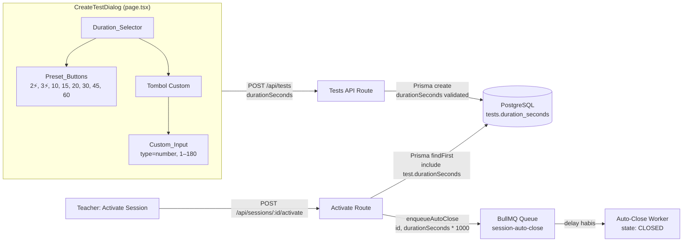

# Design Document — Custom Session Duration

## Overview

Fitur ini menambahkan fleksibilitas durasi pada dialog pembuatan paket soal (`CreateTestDialog`) di halaman `/dashboard/tests`, sekaligus memperbaiki bug konsistensi auto-close. Perubahan mencakup tiga area:

1. **UI (`CreateTestDialog`)** — tambah preset 2 & 3 menit (ditandai "⚡ Demo") dan opsi input Custom (1–180 menit).
2. **API Server (`POST /api/tests`)** — validasi server-side untuk `durationSeconds` (integer, 60–10800, default 900).
3. **Activate Route (`POST /api/sessions/:id/activate`)** — perbaiki bug hardcode 900.000 ms dengan membaca `durationSeconds` aktual dari test terkait.

Semua perubahan bersifat additive — tidak ada migrasi schema (kolom `durationSeconds` sudah ada di tabel `tests`), tidak ada breaking change pada API contract yang ada.

---

## Architecture



**Alur kritis yang diperbaiki**: Activate Route sebelumnya memanggil `enqueueAutoClose(id, 900_000)` secara hardcode. Setelah fix, delay dikalkulasi dari `sessionPin.test.durationSeconds * 1000`.

---

## Components and Interfaces

### 1. `CreateTestDialog` (UI)

Perubahan state yang ditambahkan:

```typescript
// State baru
const [isCustom, setIsCustom] = useState(false);
const [customMinutes, setCustomMinutes] = useState("");
```

State `duration` yang ada tetap dipakai sebagai nilai final yang dikirim ke API.

**Updated `durationOptions` array:**

```typescript
const durationOptions = [
  { label: "2 menit", value: 120, isDemo: true },
  { label: "3 menit", value: 180, isDemo: true },
  { label: "10 menit", value: 600 },
  { label: "15 menit", value: 900 },
  { label: "20 menit", value: 1200 },
  { label: "30 menit", value: 1800 },
  { label: "45 menit", value: 2700 },
  { label: "60 menit", value: 3600 },
];
```

**Logika validasi Custom_Input:**

```typescript
// Utility: parse dan validasi input custom
function parseCustomMinutes(raw: string): {
  valid: boolean;
  minutes: number | null;
  error: string | null;
} {
  if (raw === "" || raw === null) return { valid: false, minutes: null, error: null };
  const num = parseFloat(raw);
  if (isNaN(num)) return { valid: false, minutes: null, error: null };
  const rounded = Math.round(num);
  if (rounded < 1) return { valid: false, minutes: null, error: "Minimal 1 menit" };
  if (rounded > 180) return { valid: false, minutes: null, error: "Maksimal 180 menit (3 jam)" };
  return { valid: true, minutes: rounded, error: null };
}
```

**Kondisi disable submit:**

```typescript
const isSubmitDisabled = loading || !classId || !topic
  || (isCustom && parseCustomMinutes(customMinutes).valid === false);
```

**Handler pilih preset:**

```typescript
function handleSelectPreset(value: number) {
  setIsCustom(false);
  setCustomMinutes("");
  setDuration(value);
}

function handleSelectCustom() {
  setIsCustom(true);
  // duration tidak diubah sampai input valid dimasukkan
}
```

**Handler custom input change:**

```typescript
function handleCustomChange(raw: string) {
  setCustomMinutes(raw);
  const { valid, minutes } = parseCustomMinutes(raw);
  if (valid && minutes !== null) {
    setDuration(minutes * 60);
  }
}
```

---

### 2. `POST /api/tests` — Validasi Server-Side

Tambah blok validasi setelah parsing body, sebelum query DB:

```typescript
// Validasi durationSeconds
const dur = durationSeconds ?? 900;
if (
  typeof dur !== "number" ||
  !Number.isInteger(dur) ||
  dur < 60 ||
  dur > 10800
) {
  return NextResponse.json(
    {
      success: false,
      error: {
        code: "VALIDATION_ERROR",
        message: "durationSeconds harus berupa bilangan bulat antara 60 dan 10800.",
      },
    },
    { status: 422 }
  );
}
```

Interface `POST` body setelah perubahan:

```typescript
interface CreateTestBody {
  classId?: string;
  topic?: string;
  durationSeconds?: number; // optional; default 900; valid: integer 60–10800
}
```

---

### 3. `POST /api/sessions/:id/activate` — Fix Auto-Close Bug

**Perubahan query Prisma** — tambah `test { durationSeconds }` ke `select`:

```typescript
const sessionPin = await prisma.sessionPin.findFirst({
  where: { id, schoolId: session.schoolId },
  select: {
    id: true,
    state: true,
    schoolId: true,
    test: {
      select: { durationSeconds: true },
    },
  },
});
```

**Guard untuk durationSeconds tidak valid — fallback ke 900 detik:**

Sesi lama yang dibuat sebelum kolom ini punya nilai valid (mis. `durationSeconds = 0` atau `null`) tidak boleh crash saat di-activate. Strategi: fallback ke 900 detik (15 menit) sebagai nilai aman, bukan return error, supaya backward compatible.

```typescript
const rawDuration = sessionPin.test?.durationSeconds ?? 0;
const safeDuration = rawDuration > 0 ? rawDuration : 900; // fallback 15 menit untuk sesi lama
const durationMs = safeDuration * 1000;
```

Fallback ini hanya berlaku untuk sesi lama yang kemungkinan memiliki `durationSeconds` tidak valid. Sesi baru yang dibuat setelah validasi server-side di `POST /api/tests` ditambahkan dijamin selalu memiliki nilai valid (60–10800).
```

**Enqueue dengan delay dinamis (ganti baris hardcode):**

```typescript
// Sebelum: await enqueueAutoClose(id, 900_000);
await enqueueAutoClose(id, durationMs);
```

---

## Data Models

Tidak ada perubahan schema. Kolom yang relevan sudah ada:

```prisma
model Test {
  durationSeconds Int @default(900) @map("duration_seconds")
  // ...
}
```

**Batasan nilai yang dijamin**:
- Database: tidak ada constraint (kolom Int biasa).
- Server-side (API layer): 60 ≤ `durationSeconds` ≤ 10800, integer.
- Client-side (UI layer): 1 ≤ custom minutes ≤ 180 (ekuivalen 60–10800 detik). Preset demo 2 & 3 menit (120, 180 detik) berada di luar batas 60 detik minimal server — **catatan: server menerima nilai ≥ 60, dan 120/180 keduanya valid**.

**Mapping menit → detik:**

| UI Label | value (detik) | isDemo |
|----------|--------------|--------|
| 2 menit  | 120          | ✓      |
| 3 menit  | 180          | ✓      |
| 10 menit | 600          |        |
| 15 menit | 900          |        |
| 20 menit | 1200         |        |
| 30 menit | 1800         |        |
| 45 menit | 2700         |        |
| 60 menit | 3600         |        |
| Custom   | N × 60       |        |

---

## Correctness Properties

*A property is a characteristic or behavior that should hold true across all valid executions of a system — essentially, a formal statement about what the system should do. Properties serve as the bridge between human-readable specifications and machine-verifiable correctness guarantees.*

### Property 1: Single Active Selection

*For any* Duration_Selector, after clicking any button (any preset or Custom), exactly one button should be marked as active and all others should be inactive.

**Validates: Requirements 1.3, 1.4, 2.3, 5.2**

---

### Property 2: Custom Input Multiplier

*For any* integer N in the range [1, 180], entering N into Custom_Input should cause the internal duration state to be set to exactly N × 60 seconds.

**Validates: Requirements 2.4**

---

### Property 3: Decimal Rounding

*For any* decimal number D entered into Custom_Input where `Math.round(D)` falls in [1, 180], the stored duration should equal `Math.round(D) × 60` seconds.

**Validates: Requirements 2.7**

---

### Property 4: Invalid Custom Input Disables Submit

*For any* input value that is empty, non-numeric, less than 1, or greater than 180 while Custom mode is active, the submit button should be disabled.

**Validates: Requirements 2.5, 2.6, 2.8, 2.9**

---

### Property 5: Server Rejects Out-of-Range durationSeconds

*For any* integer value outside the range [60, 10800], `POST /api/tests` should return HTTP 422 with error code `VALIDATION_ERROR`.

**Validates: Requirements 3.1, 3.2**

---

### Property 6: Server Rejects Non-Integer durationSeconds

*For any* non-integer numeric value (e.g. 90.5, 1.1) sent as `durationSeconds`, `POST /api/tests` should return HTTP 422 with error code `VALIDATION_ERROR`.

**Validates: Requirements 3.3**

---

### Property 7: Server Persists Exact Valid durationSeconds

*For any* valid integer `durationSeconds` in [60, 10800], a successful `POST /api/tests` should create a test record with `durationSeconds` equal to exactly the submitted value.

**Validates: Requirements 3.5, 1.6, 1.7**

---

### Property 8: Activate Route Delay Equals durationSeconds × 1000

*For any* session linked to any test with any valid `durationSeconds` value, activating the session should schedule the auto-close job with a delay of exactly `durationSeconds × 1000` milliseconds.

**Validates: Requirements 4.1, 4.2, 5.4**

---

### Property 9: Auto-Close Idempotency

*For any* session already in `CLOSED` state, executing the auto-close job should not modify the session data (state, closedAt remain unchanged) and should complete without error.

**Validates: Requirements 4.5**

---

## Error Handling

| Scenario | Layer | HTTP Status | Error Code | Pesan |
|----------|-------|------------|------------|-------|
| `durationSeconds` < 60 | API `/api/tests` | 422 | `VALIDATION_ERROR` | "durationSeconds harus berupa bilangan bulat antara 60 dan 10800." |
| `durationSeconds` > 10800 | API `/api/tests` | 422 | `VALIDATION_ERROR` | "durationSeconds harus berupa bilangan bulat antara 60 dan 10800." |
| `durationSeconds` non-integer | API `/api/tests` | 422 | `VALIDATION_ERROR` | "durationSeconds harus berupa bilangan bulat antara 60 dan 10800." |
| `durationSeconds` non-numeric | API `/api/tests` | 422 | `VALIDATION_ERROR` | "durationSeconds harus berupa bilangan bulat antara 60 dan 10800." |
| Custom input < 1 menit | UI | — | — | Inline: "Minimal 1 menit" + disable submit |
| Custom input > 180 menit | UI | — | — | Inline: "Maksimal 180 menit (3 jam)" + disable submit |
| Custom input kosong / non-numerik | UI | — | — | Disable submit (tanpa pesan error eksplisit) |
| `durationSeconds` = 0 atau null saat activate (sesi lama) | API `/api/sessions/:id/activate` | — | — | Fallback ke 900 detik (15 menit), sesi tetap diaktifkan normal |
| Sesi tidak ditemukan saat activate | API `/api/sessions/:id/activate` | 404 | `NOT_FOUND` | "Sesi tidak ditemukan atau bukan milik sekolah Anda." |
| State transition tidak valid | API `/api/sessions/:id/activate` | 409 | `INVALID_TRANSITION` | Pesan dari state machine |

**Error UI propagation**: Error dari `POST /api/tests` ditampilkan melalui `setError(r.error.message)` yang sudah ada di `CreateTestDialog` — tidak ada perubahan mekanisme, hanya pesan error baru yang bisa muncul jika validasi server gagal.

---

## Testing Strategy

### Pendekatan

Proyek menggunakan **Vitest** untuk unit/integration test dan **fast-check** untuk property-based testing (PBT). Kedua library sudah ada di `devDependencies`. Tidak perlu menambahkan dependency baru.

### Unit Tests (Vitest — example-based)

Fokus pada specific scenarios dan initial state:

- Render `CreateTestDialog`: verifikasi semua 8 preset lama+baru hadir dengan label yang benar dan dalam urutan yang benar.
- Render `CreateTestDialog`: tombol 2 menit dan 3 menit memiliki label "⚡ Demo".
- Render `CreateTestDialog`: tombol "Custom" hadir sebagai pilihan terakhir.
- Initial state: `duration = 900` (preset 15 menit terpilih) saat dialog pertama dibuka.
- `POST /api/tests` tanpa `durationSeconds`: test dibuat dengan `durationSeconds = 900`.
- Query Prisma di Activate Route: memverifikasi `include: { test: { select: { durationSeconds: true } } }` ada.

### Property-Based Tests (fast-check)

Setiap property test dikonfigurasi minimum 100 iterasi. Tag format: `Feature: custom-session-duration, Property {N}: {teks singkat}`.

**Property 1 — Single Active Selection**
```
// Feature: custom-session-duration, Property 1: single active selection
fc.assert(fc.property(
  fc.constantFrom(...allOptions), // semua tombol termasuk Custom
  (selected) => {
    // render, klik selected, verifikasi hanya selected yang punya class aktif
  }
), { numRuns: 100 });
```

**Property 2 — Custom Input Multiplier**
```
// Feature: custom-session-duration, Property 2: custom input multiplier
fc.assert(fc.property(
  fc.integer({ min: 1, max: 180 }),
  (minutes) => {
    handleCustomChange(String(minutes));
    expect(duration).toBe(minutes * 60);
  }
), { numRuns: 100 });
```

**Property 3 — Decimal Rounding**
```
// Feature: custom-session-duration, Property 3: decimal rounding
fc.assert(fc.property(
  fc.float({ min: 1.0, max: 180.0, noNaN: true }),
  (dec) => {
    const rounded = Math.round(dec);
    if (rounded >= 1 && rounded <= 180) {
      const { minutes } = parseCustomMinutes(String(dec));
      expect(minutes).toBe(rounded);
    }
  }
), { numRuns: 100 });
```

**Property 4 — Invalid Custom Input Disables Submit**
```
// Feature: custom-session-duration, Property 4: invalid custom disables submit
fc.assert(fc.property(
  fc.oneof(
    fc.constant(""),
    fc.string().filter(s => isNaN(parseFloat(s))),
    fc.integer({ max: 0 }).map(String),
    fc.integer({ min: 181 }).map(String),
  ),
  (invalidInput) => {
    // set isCustom=true, set customMinutes=invalidInput
    // submit button harus disabled
  }
), { numRuns: 100 });
```

**Property 5 — Server Rejects Out-of-Range**
```
// Feature: custom-session-duration, Property 5: server rejects out-of-range durationSeconds
fc.assert(fc.property(
  fc.oneof(fc.integer({ max: 59 }), fc.integer({ min: 10801 })),
  async (dur) => {
    const res = await POST(mockRequest({ durationSeconds: dur }), ctx);
    expect(res.status).toBe(422);
    const body = await res.json();
    expect(body.error.code).toBe("VALIDATION_ERROR");
  }
), { numRuns: 100 });
```

**Property 6 — Server Rejects Non-Integer**
```
// Feature: custom-session-duration, Property 6: server rejects non-integer durationSeconds
fc.assert(fc.property(
  fc.float({ min: 60, max: 10800, noNaN: true }).filter(n => !Number.isInteger(n)),
  async (dur) => {
    const res = await POST(mockRequest({ durationSeconds: dur }), ctx);
    expect(res.status).toBe(422);
  }
), { numRuns: 100 });
```

**Property 7 — Server Persists Exact durationSeconds**
```
// Feature: custom-session-duration, Property 7: server persists exact valid durationSeconds
fc.assert(fc.property(
  fc.integer({ min: 60, max: 10800 }),
  async (dur) => {
    // mock prisma.test.create
    const res = await POST(mockRequest({ durationSeconds: dur, classId: "...", topic: "..." }), ctx);
    expect(res.status).toBe(201);
    expect(capturedCreateData.durationSeconds).toBe(dur);
  }
), { numRuns: 100 });
```

**Property 8 — Activate Route Delay**
```
// Feature: custom-session-duration, Property 8: activate route delay equals durationSeconds * 1000
fc.assert(fc.property(
  fc.integer({ min: 60, max: 10800 }),
  async (dur) => {
    // mock prisma findFirst returning session with test.durationSeconds = dur
    // mock enqueueAutoClose to capture arguments
    await POST(mockRequest(), { params: { id: "session-id" } });
    expect(capturedDelay).toBe(dur * 1000);
  }
), { numRuns: 100 });
```

**Property 9 — Auto-Close Idempotency**
```
// Feature: custom-session-duration, Property 9: auto-close idempotency on CLOSED sessions
fc.assert(fc.property(
  fc.record({ id: fc.uuid(), state: fc.constant("CLOSED"), closedAt: fc.date() }),
  async (closedSession) => {
    // mock prisma returning closedSession
    // run processAutoClose
    // verify prisma.update was NOT called
  }
), { numRuns: 100 });
```

### Integration Tests

- Activate Route end-to-end dengan database test: verifikasi `closedAt` di-set dalam toleransi ≤ 5 detik setelah job dieksekusi (Requirement 4.3).
- Verifikasi query Prisma di Activate Route menyertakan `test.durationSeconds` (Requirement 4.4).

### Test File Structure

```
src/
  __tests__/
    custom-session-duration/
      create-test-dialog.test.tsx    # Unit + PBT untuk UI
      api-tests-route.test.ts        # Unit + PBT untuk POST /api/tests
      activate-route.test.ts         # Unit + PBT untuk activate route
      auto-close-worker.test.ts      # Unit + PBT untuk worker idempotency
```
