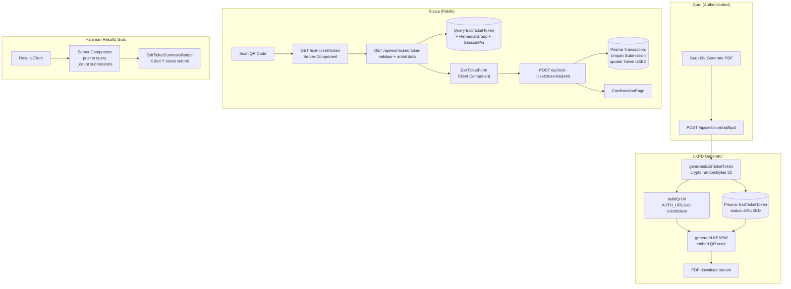

# Design Document — Exit Ticket Feature

## Overview

Fitur Exit Ticket menambahkan halaman refleksi digital publik yang dapat diakses siswa melalui QR code di PDF LKPD-KK. Fitur ini mencakup tiga bagian utama: (1) perbaikan bug pada PDF generator untuk menghasilkan URL yang benar, (2) sistem token kriptografis untuk akses tanpa login, dan (3) integrasi ringkasan submission ke halaman results guru.

## Ikhtisar

Fitur Exit Ticket menambahkan halaman refleksi digital publik yang dapat diakses siswa melalui QR code di PDF LKPD-KK. Fitur ini mencakup tiga bagian utama: (1) perbaikan bug pada PDF generator untuk menghasilkan URL yang benar, (2) sistem token kriptografis untuk akses tanpa login, dan (3) integrasi ringkasan submission ke halaman results guru.

Setelah PDF di-generate, setiap kelompok remedial mendapatkan satu token unik yang di-embed di QR code. Siswa menscan QR → membuka halaman di browser → mengisi refleksi → submit → halaman konfirmasi. Guru dapat melihat jumlah submission di halaman results yang sudah ada.

---

## Architecture

Lihat diagram di bawah — arsitektur terdiri dari tiga lapisan: LKPD Generator (server), halaman Exit Ticket publik (client+server), dan integrasi di halaman Results guru.

## Arsitektur

### Diagram Alur Komponen



### Daftar File

## Components and Interfaces

Lihat tabel file baru dan yang dimodifikasi di bawah, beserta interface TypeScript utama.

### Daftar File

| File | Deskripsi |
|------|-----------|
| `src/app/exit-ticket/[token]/page.tsx` | Server Component — load data dan render awal |
| `src/app/exit-ticket/[token]/ExitTicketForm.tsx` | Client Component — form interaktif |
| `src/app/exit-ticket/[token]/ConfirmationPage.tsx` | Client Component — halaman setelah submit |
| `src/app/exit-ticket/[token]/ErrorPage.tsx` | Komponen halaman error |
| `src/app/api/exit-ticket/[token]/route.ts` | GET endpoint — validasi token |
| `src/app/api/exit-ticket/[token]/submit/route.ts` | POST endpoint — simpan submission |
| `src/lib/exit-ticket/token.ts` | Pure functions: generate, validate, build URL |
| `src/lib/exit-ticket/theme.ts` | Mapping kategori → warna Tailwind + pertanyaan |
| `src/components/teacher/ExitTicketSummaryBadge.tsx` | Badge ringkasan untuk ResultsClient |

**File yang Dimodifikasi:**

| File | Perubahan |
|------|-----------|
| `src/app/api/sessions/[id]/lkpd/route.ts` | Generate token sebelum PDF, gunakan `AUTH_URL`, path `/exit-ticket/` |
| `src/lib/pdf/lkpd-generator.ts` | Terima `qrUrl` yang sudah benar (tidak ada perubahan internal) |
| `src/auth.config.ts` | Tambah `/exit-ticket/` dan `/api/exit-ticket/` ke `PUBLIC_ROUTES` |
| `src/app/dashboard/sessions/[id]/results/ResultsClient.tsx` | Tambah `ExitTicketSummaryBadge` di kartu kelompok |
| `src/app/dashboard/sessions/[id]/results/page.tsx` | Query `_count` submission saat load data server-side |
| `prisma/schema.prisma` | Tambah model `ExitTicketToken`, `ExitTicketSubmission`, enum `ExitTicketStatus` |

---

## Data Models

Lihat bagian Skema Database di bawah untuk model Prisma lengkap dan interface TypeScript.

## Skema Database

### Model Prisma Lengkap

```prisma
// ─── Exit Ticket ─────────────────────────────────────────────────────────────

enum ExitTicketStatus {
  UNUSED
  USED
}

model ExitTicketToken {
  id             String            @id @default(uuid())
  token          String            @unique
  sessionPinId   String            @map("session_pin_id")
  remedialGroupId String?          @map("remedial_group_id")
  schoolId       String            @map("school_id")
  status         ExitTicketStatus  @default(UNUSED)
  createdAt      DateTime          @default(now()) @map("created_at")
  usedAt         DateTime?         @map("used_at")

  session        SessionPin        @relation(fields: [sessionPinId], references: [id])
  remedialGroup  RemedialGroup?    @relation(fields: [remedialGroupId], references: [id])
  school         School            @relation(fields: [schoolId], references: [id])
  submission     ExitTicketSubmission?

  @@index([sessionPinId])
  @@map("exit_ticket_tokens")
}

model ExitTicketSubmission {
  id                 String           @id @default(uuid())
  exitTicketTokenId  String           @unique @map("exit_ticket_token_id")
  reflectionText     String           @map("reflection_text") @db.VarChar(1000)
  confidenceScore    Int              @map("confidence_score")
  submittedAt        DateTime         @default(now()) @map("submitted_at")
  schoolId           String           @map("school_id")

  exitTicketToken    ExitTicketToken  @relation(fields: [exitTicketTokenId], references: [id])
  school             School           @relation(fields: [schoolId], references: [id])

  @@map("exit_ticket_submissions")
}
```

### Relasi Tambahan yang Perlu Ditambahkan

Di model `SessionPin`, `RemedialGroup`, dan `School` yang sudah ada, perlu ditambahkan relasi balik:

```prisma
// Di model SessionPin — tambahkan:
exitTicketTokens   ExitTicketToken[]

// Di model RemedialGroup — tambahkan:
exitTicketTokens   ExitTicketToken[]

// Di model School — tambahkan:
exitTicketTokens   ExitTicketToken[]
exitTicketSubmissions ExitTicketSubmission[]
```

---

## URL dan Struktur Token

### Format Token

Token dihasilkan dengan `crypto.randomBytes(32)` di-encode sebagai hex string 64 karakter:

```
[a-f0-9]{64}
```

Contoh: `a3f8c2e1b0d4596f7e2a9c1d5b8f034e7a2c6d9f1e4b8a3c0d7f2e5b9c1d4a7`

### Format URL

```
{AUTH_URL}/exit-ticket/{token}
```

Contoh: `https://remediaide.app/exit-ticket/a3f8c2e1...`

### Validasi Format Token di Server

Sebelum melakukan database query, server memvalidasi format token dari URL parameter:
- Panjang: 8–128 karakter
- Karakter yang diizinkan: `[a-zA-Z0-9-]` (alfanumerik + tanda hubung)
- Jika tidak valid → return 404 (tidak 400, untuk menghindari oracle attack)

```typescript
// src/lib/exit-ticket/token.ts
const TOKEN_REGEX = /^[a-zA-Z0-9-]{8,128}$/;

export function isValidTokenFormat(token: string): boolean {
  return TOKEN_REGEX.test(token);
}
```

### Logika Generate Token

```typescript
import crypto from 'crypto';
import { prisma } from '@/lib/db/client';

/**
 * Generate token kriptografis unik, simpan ke DB, kembalikan tokennya.
 * Throw jika penyimpanan gagal.
 */
export async function generateAndSaveToken(params: {
  sessionPinId: string;
  remedialGroupId: string;
  schoolId: string;
}): Promise<string> {
  const token = crypto.randomBytes(32).toString('hex'); // 64 char hex
  
  await prisma.exitTicketToken.create({
    data: {
      token,
      sessionPinId: params.sessionPinId,
      remedialGroupId: params.remedialGroupId,
      schoolId: params.schoolId,
      status: 'UNUSED',
    },
  });

  return token;
}
```

### Logika Build QR URL

```typescript
/**
 * Bangun QR URL dengan normalisasi trailing slash.
 * Validasi hasil URL sebelum dikembalikan.
 */
export function buildQrUrl(token: string, baseUrl?: string): string {
  const base = (baseUrl ?? '').trim() || 'https://remediaide.app';
  const normalizedBase = base.replace(/\/+$/, ''); // hapus trailing slash
  const url = `${normalizedBase}/exit-ticket/${token}`;
  
  if (!url.startsWith('http://') && !url.startsWith('https://')) {
    throw new Error(`URL tidak valid: ${url}`);
  }
  
  return url;
}
```

### Expiry Check

Token dianggap kedaluwarsa jika `createdAt` lebih dari 30 hari yang lalu. Pengecekan dilakukan di lapisan API, bukan di database:

```typescript
const EXPIRY_DAYS = 30;

export function isTokenExpired(createdAt: Date): boolean {
  const expiryMs = EXPIRY_DAYS * 24 * 60 * 60 * 1000;
  return Date.now() - createdAt.getTime() > expiryMs;
}
```

---

## Design API Endpoint

### GET `/api/exit-ticket/[token]`

**Tujuan:** Validasi token dan kembalikan data minimal yang dibutuhkan untuk menampilkan form.

**Auth:** Tidak diperlukan (public endpoint)

**Flow Validasi:**
1. Validasi format token → 404 jika tidak valid
2. Query `ExitTicketToken` by token (exact match, include relasi `session.test`)
3. Jika tidak ditemukan → 404 `TOKEN_NOT_FOUND`
4. Jika sudah kedaluwarsa (> 30 hari) → 404 `TOKEN_NOT_FOUND`
5. Jika status `USED` → 200 dengan `{ status: "USED" }` (bukan error)
6. Jika status `UNUSED` → 200 dengan data form

**Response 200 (UNUSED):**
```typescript
interface ExitTicketDataResponse {
  status: 'UNUSED';
  topicName: string;          // dari Session → Test → topic
  cognitiveCategory: CognitiveGroupType; // dari RemedialGroup.cognitiveStatus
  // TIDAK ADA: id, sessionPinId, schoolId, remedialGroupId, studentId
}
```

**Response 200 (USED):**
```typescript
interface ExitTicketUsedResponse {
  status: 'USED';
}
```

**Response Error:**
```typescript
// 404: { "error": "TOKEN_NOT_FOUND" }
// 429: { "error": "RATE_LIMIT_EXCEEDED" }
// 500: { "error": "INTERNAL_ERROR" }
```

---

### POST `/api/exit-ticket/[token]/submit`

**Tujuan:** Terima submission, simpan ke database, tandai token sebagai USED.

**Auth:** Tidak diperlukan (public endpoint)

**Request Body:**
```typescript
interface SubmitExitTicketBody {
  reflectionText: string;  // 1–1000 karakter, setelah trim
  confidenceScore: number; // integer 0–5 inklusif
}
```

**Validasi Server-side:**
- `reflectionText.trim().length` harus 1–1000
- `confidenceScore` harus integer dalam [0, 5]
- Format token valid
- Token ada di database dan tidak expired
- Token status `UNUSED`

**Flow:**
1. Validasi format token → 404
2. Validasi body → 422 `VALIDATION_ERROR`
3. Buka transaksi Prisma:
   a. Cari token dengan `status: 'UNUSED'` (atomic lock)
   b. Jika tidak ditemukan atau USED → abort → 409 `TOKEN_ALREADY_USED`
   c. Buat `ExitTicketSubmission`
   d. Update token: `status: 'USED'`, `usedAt: new Date()`
4. Commit transaksi
5. Response 200 `{ success: true }`

**Response sukses:**
```json
{ "success": true }
```

**Response error:**
```typescript
// 404: { "error": "TOKEN_NOT_FOUND" }
// 409: { "error": "TOKEN_ALREADY_USED" }
// 422: { "error": "VALIDATION_ERROR", "field": "reflectionText" | "confidenceScore" }
// 429: { "error": "RATE_LIMIT_EXCEEDED" }
// 500: { "error": "INTERNAL_ERROR" }
```

**Kenapa Transaksi:** Penting untuk memastikan atomicity — tidak boleh ada submission tersimpan tanpa token ditandai USED, dan sebaliknya. Prisma `$transaction` menjamin ini.

---

## Design Halaman Exit Ticket

### Route Structure

```
src/app/exit-ticket/
└── [token]/
    ├── page.tsx              ← Server Component (data fetching)
    ├── ExitTicketForm.tsx    ← Client Component (form interaktif)
    ├── ConfirmationPage.tsx  ← Client Component (setelah submit)
    └── ErrorPage.tsx         ← Komponen error (USED, NOT_FOUND, dll)
```

### Server Component (`page.tsx`)

Server Component melakukan validasi format token dan fetch data awal secara server-side (bukan client fetch), meningkatkan performa dan SEO:

```typescript
// src/app/exit-ticket/[token]/page.tsx
import { notFound } from 'next/navigation';
import { isValidTokenFormat } from '@/lib/exit-ticket/token';
import ExitTicketForm from './ExitTicketForm';
import ErrorPage from './ErrorPage';
import ConfirmationPage from './ConfirmationPage';

export default async function ExitTicketPage({
  params: { token }
}: { params: { token: string } }) {
  // Validasi format — render 404 sebelum query DB
  if (!isValidTokenFormat(token)) notFound();
  
  // Fetch langsung dari DB (server-side, bukan API call)
  // Query hanya field yang dibutuhkan — tidak ada id, schoolId, dll
  const tokenData = await fetchExitTicketData(token);
  
  if (!tokenData) return <ErrorPage type="NOT_FOUND" />;
  if (tokenData.status === 'USED') return <ConfirmationPage alreadySubmitted />;
  
  return <ExitTicketForm
    token={token}
    topicName={tokenData.topicName}
    cognitiveCategory={tokenData.cognitiveCategory}
  />;
}
```

### Interface TypeScript Utama

```typescript
// src/lib/exit-ticket/theme.ts

export type CognitiveGroupType =
  | 'PAHAM_KONSEP'
  | 'LUCKY_GUESS'
  | 'MISKONSEPSI'
  | 'TIDAK_PAHAM'
  | 'INSUFFICIENT_DATA';

export interface CategoryTheme {
  /** Tailwind background class untuk header dan aksen */
  bgClass: string;
  /** Tailwind text class untuk heading */
  headingClass: string;
  /** Tailwind class untuk tombol submit */
  buttonClass: string;
  /** Label yang ditampilkan di halaman */
  label: string;
  /** Pertanyaan refleksi yang ditampilkan di form */
  reflectionQuestion: string;
}

export const CONFIDENCE_LABELS: Record<number, string> = {
  0: 'Menebak Sepenuhnya',
  1: 'Sangat Tidak Yakin',
  2: 'Tidak Yakin',
  3: 'Yakin',
  4: 'Sangat Yakin',
  5: 'Mutlak Yakin',
};
```

---

## Mapping Tema Kategori

Warna diambil langsung dari `GROUP_COLORS` di `lkpd-generator.ts` dan dikonversi ke kelas Tailwind yang setara. Ini menjamin konsistensi visual antara PDF dan halaman web.

| Kategori | PDF (`GROUP_COLORS`) | Tailwind Equivalent | Label | Pertanyaan Refleksi |
|----------|---------------------|---------------------|-------|---------------------|
| `PAHAM_KONSEP` | `r:0.08, g:0.50, b:0.24` (green-700) | `bg-green-700` | Paham Konsep | "Coba jelaskan dengan kata-katamu sendiri, apa yang membuatmu yakin dengan jawabanmu?" |
| `LUCKY_GUESS` | `r:0.63, g:0.38, b:0.04` (yellow-700) | `bg-yellow-700` | Lucky Guess | "Coba jelaskan lagi alasan jawabanmu sekarang, setelah mengerjakan LKPD ini — apakah alasanmu berubah?" |
| `MISKONSEPSI` | `r:0.73, g:0.11, b:0.11` (red-700) | `bg-red-700` | Miskonsepsi | "Apa yang berubah dari pemahamanmu setelah mengerjakan LKPD ini? Bagian mana yang tadinya kamu pikir benar, ternyata berbeda?" |
| `TIDAK_PAHAM` | `r:0.12, g:0.23, b:0.54` (blue-900) | `bg-blue-900` | Tidak Paham | "Bagian mana dari topik ini yang masih paling membingungkan buatmu?" |
| `INSUFFICIENT_DATA` | `r:0.42, g:0.45, b:0.50` (gray-500) | `bg-gray-500` | Data Tidak Cukup | "Ceritakan bagaimana proses kamu mengerjakan soal tadi — apa yang kamu lakukan saat menemui soal yang sulit?" |

### Implementasi Mapping

```typescript
// src/lib/exit-ticket/theme.ts

export const CATEGORY_THEMES: Record<CognitiveGroupType, CategoryTheme> = {
  PAHAM_KONSEP: {
    bgClass: 'bg-green-700',
    headingClass: 'text-green-800',
    buttonClass: 'bg-green-700 hover:bg-green-800',
    label: 'Paham Konsep',
    reflectionQuestion:
      'Coba jelaskan dengan kata-katamu sendiri, apa yang membuatmu yakin dengan jawabanmu?',
  },
  LUCKY_GUESS: {
    bgClass: 'bg-yellow-700',
    headingClass: 'text-yellow-800',
    buttonClass: 'bg-yellow-700 hover:bg-yellow-800',
    label: 'Lucky Guess',
    reflectionQuestion:
      'Coba jelaskan lagi alasan jawabanmu sekarang, setelah mengerjakan LKPD ini — apakah alasanmu berubah?',
  },
  MISKONSEPSI: {
    bgClass: 'bg-red-700',
    headingClass: 'text-red-800',
    buttonClass: 'bg-red-700 hover:bg-red-800',
    label: 'Miskonsepsi',
    reflectionQuestion:
      'Apa yang berubah dari pemahamanmu setelah mengerjakan LKPD ini? Bagian mana yang tadinya kamu pikir benar, ternyata berbeda?',
  },
  TIDAK_PAHAM: {
    bgClass: 'bg-blue-900',
    headingClass: 'text-blue-900',
    buttonClass: 'bg-blue-900 hover:bg-blue-950',
    label: 'Tidak Paham',
    reflectionQuestion:
      'Bagian mana dari topik ini yang masih paling membingungkan buatmu?',
  },
  INSUFFICIENT_DATA: {
    bgClass: 'bg-gray-500',
    headingClass: 'text-gray-700',
    buttonClass: 'bg-gray-500 hover:bg-gray-600',
    label: 'Data Tidak Cukup',
    reflectionQuestion:
      'Ceritakan bagaimana proses kamu mengerjakan soal tadi — apa yang kamu lakukan saat menemui soal yang sulit?',
  },
};
```

---

## Model Data

### Interface Request/Response

```typescript
// Tipe data yang aman dikirim ke client (tidak ada field sensitif)
export interface ExitTicketPublicData {
  status: 'UNUSED' | 'USED';
  topicName?: string;
  cognitiveCategory?: CognitiveGroupType;
}

// Payload submit dari client
export interface SubmitPayload {
  reflectionText: string;
  confidenceScore: number;
}

// State internal form (tidak pernah dikirim ke server selain reflectionText dan confidenceScore)
export interface FormState {
  reflectionText: string;
  confidenceScore: number | null;
  isSubmitting: boolean;
  submitError: string | null;
  isSuccess: boolean;
  validationErrors: {
    reflectionText?: string;
    confidenceScore?: string;
  };
}
```

---

## Titik Integrasi

### 1. Modifikasi LKPD Generator Route

File `src/app/api/sessions/[id]/lkpd/route.ts` perlu diubah di bagian "Build QR URL":

```typescript
// SEBELUM (buggy):
const baseUrl = process.env.NEXTAUTH_URL ?? 'https://remediaide.app';
const qrUrl = `${baseUrl}/student/join`;

// SESUDAH (correct):
import { generateAndSaveToken, buildQrUrl } from '@/lib/exit-ticket/token';

// Setelah load group data:
const exitToken = await generateAndSaveToken({
  sessionPinId: sessionId,
  remedialGroupId: body.groupId,
  schoolId: session.schoolId,
});

const rawBaseUrl = process.env.AUTH_URL;
if (!rawBaseUrl) {
  console.warn('[lkpd] AUTH_URL tidak disetel, menggunakan fallback URL');
}
const qrUrl = buildQrUrl(exitToken, rawBaseUrl);
```

### 2. Modifikasi `auth.config.ts` — Tambah Public Routes

```typescript
// Di PUBLIC_ROUTES array, tambahkan:
/^\/exit-ticket(\/.*)?$/,
/^\/api\/exit-ticket\/.*/,
```

### 3. Modifikasi Results Page — Server-Side Data

Di `src/app/dashboard/sessions/[id]/results/page.tsx`, tambahkan query untuk submission count:

```typescript
// Tambahkan ke query groups yang sudah ada:
const groups = await prisma.remedialGroup.findMany({
  where: { sessionPinId: id },
  include: {
    exitTicketTokens: {
      select: {
        status: true,
        submission: { select: { id: true } },
      },
    },
  },
  orderBy: { cognitiveStatus: 'asc' },
});
```

Kemudian di `ResultsClient`, hitung submission count dari data yang sudah ada:

```typescript
// Di dalam kartu kelompok, di bawah member labels:
<ExitTicketSummaryBadge
  submittedCount={exitTicketTokens.filter(t => t.status === 'USED').length}
  totalTokens={exitTicketTokens.length}
/>
```

### 4. ExitTicketSummaryBadge Component

```typescript
// src/components/teacher/ExitTicketSummaryBadge.tsx
interface Props {
  submittedCount: number;
  totalTokens: number;
}

export function ExitTicketSummaryBadge({ submittedCount, totalTokens }: Props) {
  if (totalTokens === 0) return null;
  
  const memberCount = totalTokens; // 1 token per group untuk shared submission
  
  if (submittedCount === 0) {
    return (
      <p className="text-xs text-gray-400 mt-2">Belum ada yang submit Exit Ticket</p>
    );
  }
  
  return (
    <p className="text-xs text-gray-600 mt-2">
      <span className="font-semibold text-green-700">{submittedCount}</span>
      {' '}dari {memberCount} kelompok sudah submit Exit Ticket
    </p>
  );
}
```

> **Catatan Desain:** Per requirements, satu token mewakili satu kelompok. Karena `remedialGroupId` di token nullable, satu generate PDF menghasilkan satu token. Jadi `totalTokens` = jumlah LKPD yang di-generate untuk kelompok ini, dan `submittedCount` = berapa yang sudah submit.

---

## Keamanan

### Rate Limiting

Proyek sudah memiliki `ioredis` dan `bullmq` sebagai dependensi, yang mengindikasikan Redis tersedia. Namun, untuk rate limiting di endpoint publik, pendekatan yang paling sederhana dan sesuai dengan arsitektur Next.js saat ini adalah menggunakan **in-memory rate limiting dengan Map** untuk development, dan **Redis-based** untuk production.

Implementasi menggunakan middleware atau helper di dalam route handler:

```typescript
// src/lib/exit-ticket/rate-limit.ts

const WINDOW_MS = 60 * 1000; // 1 menit
const MAX_REQUESTS = 20;

// In-memory store (per-process, cukup untuk pilot scale)
// Untuk production horizontal scaling, ganti dengan Redis
const rateLimitStore = new Map<string, { count: number; resetAt: number }>();

export function checkRateLimit(ip: string): { allowed: boolean; retryAfter?: number } {
  const now = Date.now();
  const entry = rateLimitStore.get(ip);
  
  if (!entry || now > entry.resetAt) {
    rateLimitStore.set(ip, { count: 1, resetAt: now + WINDOW_MS });
    return { allowed: true };
  }
  
  if (entry.count >= MAX_REQUESTS) {
    return { allowed: false, retryAfter: Math.ceil((entry.resetAt - now) / 1000) };
  }
  
  entry.count++;
  return { allowed: true };
}
```

Rate limiting diterapkan di kedua endpoint:
- `GET /api/exit-ticket/[token]` — 20 req/menit/IP
- `POST /api/exit-ticket/[token]/submit` — 20 req/menit/IP

### Data yang TIDAK Boleh Diekspos ke Client

Response dari GET `/api/exit-ticket/[token]` hanya boleh mengandung:
- `status` (UNUSED/USED)
- `topicName` (dari `test.topic`)
- `cognitiveCategory` (dari `remedialGroup.cognitiveStatus`)

Field yang TIDAK BOLEH diekspos:
- `id` (UUID token)
- `sessionPinId`
- `schoolId`
- `remedialGroupId`
- `studentId` atau `anonymousLabel` manapun
- Jawaban kuis individual
- Data identitas apapun

### Token Security Properties

- **Entropi:** 32 bytes = 256 bits → jauh melampaui minimum 128 bit di requirements
- **Format:** 64-char hex → `10^77` kemungkinan nilai, brute-force tidak praktis
- **Lookup:** Exact match via `WHERE token = $1` — tidak ada prefix matching
- **Expiry:** 30 hari hardcoded, dicek di aplikasi (bukan DB level) untuk fleksibilitas
- **One-time use:** Transaksi atomik memastikan token tidak bisa digunakan dua kali

---

## Error Handling

Lihat bagian "Penanganan Error" di bawah untuk tabel lengkap error states dan strategi penanganannya.

## Penanganan Error

### Error States di Halaman Exit Ticket

| Kondisi | Tampilan | HTTP Status |
|---------|----------|-------------|
| Token format tidak valid (panjang/karakter) | `notFound()` → 404 Next.js | — |
| Token tidak ada di DB | `ErrorPage type="NOT_FOUND"` — "Link ini tidak valid atau sudah tidak berlaku." | — |
| Token sudah expired (>30 hari) | `ErrorPage type="NOT_FOUND"` — pesan sama | — |
| Token status USED | `ConfirmationPage alreadySubmitted` — "Refleksimu sudah tercatat sebelumnya. Terima kasih!" | — |
| Data sesi/kelompok tidak ditemukan | `ErrorPage type="DATA_NOT_FOUND"` — "Data refleksi tidak ditemukan. Hubungi gurumu." | — |
| Submit gagal (network error) | Error inline di form — "Terjadi kesalahan, coba lagi." | — |
| Submit conflict (token USED) | Error inline — redirect ke konfirmasi statis | — |

### Error States di API

| Kondisi | HTTP | Body |
|---------|------|------|
| Format token invalid | 404 | — (no body, treated as not found) |
| Token tidak ditemukan | 404 | `{ "error": "TOKEN_NOT_FOUND" }` |
| Token sudah USED (submit) | 409 | `{ "error": "TOKEN_ALREADY_USED" }` |
| Validasi payload gagal | 422 | `{ "error": "VALIDATION_ERROR", "field": "..." }` |
| Rate limit exceeded | 429 | `{ "error": "RATE_LIMIT_EXCEEDED" }` |
| Database error | 500 | `{ "error": "INTERNAL_ERROR" }` |

### Strategi Error Handling Umum

- Semua error API menggunakan error code string yang terdefinisi (tidak mengekspos stack trace atau pesan DB)
- Server Component menggunakan `notFound()` dari Next.js untuk invalid token format
- Client Component menangkap fetch error dan menampilkan pesan user-friendly
- Transaksi database menggunakan `prisma.$transaction` dengan rollback otomatis jika terjadi error

---

## Testing Strategy

Lihat bagian "Strategi Testing" di bawah untuk pendekatan dual testing dan konfigurasi property-based tests.

## Strategi Testing

### Pendekatan Dual Testing

Fitur ini menggunakan **kombinasi property-based tests dan unit tests**. Library yang digunakan adalah **Vitest** (sudah ada) + **fast-check** (sudah ada sebagai devDependency).

### Unit Tests (Spesifik)

Tests dengan contoh konkret untuk:
- Render komponen dengan berbagai state (UNUSED, USED, NOT_FOUND, loading)
- Validasi form: submit kosong, submit tanpa skala keyakinan
- Auth config: route `/exit-ticket/*` termasuk dalam PUBLIC_ROUTES
- Error messages yang tepat ditampilkan untuk setiap error code
- `ConfirmationPage` dengan `alreadySubmitted=true` vs false
- E2E mobile: viewport 320px tidak ada horizontal scroll (Playwright)

### Property-Based Tests

Menggunakan **fast-check** dengan minimal **100 iterasi** per property. Setiap test ditandai dengan tag referensi ke property design.

**Konfigurasi:**
```typescript
// Contoh tag format:
// Feature: exit-ticket-feature, Property 1: Token generation produces unique values
```

---

## Correctness Properties

*A property is a characteristic or behavior that should hold true across all valid executions of a system — essentially, a formal statement about what the system should do. Properties serve as the bridge between human-readable specifications and machine-verifiable correctness guarantees.*

Fitur Exit Ticket memiliki beberapa fungsi pure yang sangat cocok untuk property-based testing: token generation, URL building, validasi format, category mapping, dan validasi input form. Library **fast-check** sudah tersedia sebagai devDependency.

---

### Property 1: Token generation menghasilkan nilai yang selalu unik

*Untuk sembarang* set N panggilan ke `crypto.randomBytes(32).toString('hex')`, semua token yang dihasilkan harus berbeda satu sama lain — tidak ada dua token yang bernilai sama dalam satu batch generate.

**Validates: Requirements 1.2, 6.1**

---

### Property 2: Token yang di-generate selalu memiliki format dan panjang yang valid

*Untuk sembarang* panggilan ke `generateToken()`, token yang dihasilkan harus (a) berupa string dengan tepat 64 karakter, dan (b) hanya mengandung karakter heksadesimal `[0-9a-f]`.

**Validates: Requirements 1.1, 6.1**

---

### Property 3: buildQrUrl menghasilkan URL dengan format yang benar untuk sembarang token dan base URL

*Untuk sembarang* string token valid (alfanumerik, 8–128 karakter) dan base URL valid (dimulai dengan http:// atau https://), fungsi `buildQrUrl` harus menghasilkan URL yang (a) mengandung substring `/exit-ticket/{token}` persis, dan (b) dimulai dengan `http://` atau `https://`.

**Validates: Requirements 1.4, 2.2, 2.4**

---

### Property 4: buildQrUrl menghilangkan semua trailing slash tanpa menghasilkan double slash

*Untuk sembarang* base URL valid dengan satu atau lebih trailing slash (misal `https://app.com/`, `https://app.com//`), hasil `buildQrUrl` tidak boleh mengandung substring `//` setelah bagian protokol (`://`).

**Validates: Requirements 2.3**

---

### Property 5: isValidTokenFormat menolak semua string di luar rentang 8–128 karakter atau dengan karakter tidak valid

*Untuk sembarang* string yang (a) panjangnya di luar rentang [8, 128], atau (b) mengandung karakter selain `[a-zA-Z0-9-]`, fungsi `isValidTokenFormat` harus mengembalikan `false`.

**Validates: Requirements 4.3**

---

### Property 6: CATEGORY_THEMES mendefinisikan tema lengkap untuk semua 5 kategori kognitif

*Untuk sembarang* nilai dari himpunan `{PAHAM_KONSEP, MISKONSEPSI, LUCKY_GUESS, TIDAK_PAHAM, INSUFFICIENT_DATA}`, `CATEGORY_THEMES[kategori].reflectionQuestion` harus berupa string non-empty, dan `CATEGORY_THEMES[kategori].bgClass` harus berupa string Tailwind class non-empty.

**Validates: Requirements 3.1, 3.2, 3.5**

---

### Property 7: CONFIDENCE_LABELS mendefinisikan label untuk semua nilai Skala_Keyakinan 0–5

*Untuk sembarang* integer dalam rentang [0, 5], `CONFIDENCE_LABELS[nilai]` harus berupa string non-empty yang terdefinisi.

**Validates: Requirements 3.4**

---

### Property 8: Validasi form menolak sembarang teks yang terdiri hanya dari whitespace

*Untuk sembarang* string yang hanya mengandung karakter whitespace (spasi, tab, newline, kombinasinya), fungsi validasi `isValidReflectionText` harus mengembalikan `false` dan form tidak boleh melanjutkan submission ke server.

**Validates: Requirements 5.3**

---

### Property 9: Setelah submit berhasil, status token berubah menjadi USED (submit round-trip)

*Untuk sembarang* kombinasi valid `reflectionText` (1–1000 karakter, non-whitespace) dan `confidenceScore` (integer 0–5), setelah `POST /api/exit-ticket/{token}/submit` menghasilkan status 200, query ke `exitTicketToken` dengan token yang sama harus mengembalikan `status = 'USED'`.

**Validates: Requirements 5.5, 5.6**

---

### Property 10: Submit dengan token yang sudah USED selalu menghasilkan HTTP 409

*Untuk sembarang* token dengan status `USED` di database, sembarang POST ke `/api/exit-ticket/{token}/submit` harus menghasilkan HTTP 409 dengan body `{ "error": "TOKEN_ALREADY_USED" }` — tidak peduli isi `reflectionText` atau `confidenceScore`.

**Validates: Requirements 5.9**

---

### Property 11: Response API tidak mengekspos field sensitif untuk sembarang token valid

*Untuk sembarang* token dengan status `UNUSED` yang valid, response dari `GET /api/exit-ticket/{token}` tidak boleh mengandung properti: `id`, `sessionPinId`, `schoolId`, `remedialGroupId`, `studentId`, atau field dengan nama yang mengandung "label" atau "anonymous".

**Validates: Requirements 4.4, 6.4**

---

### Refleksi Property (Penghapusan Redundansi)

Setelah review:
- Property 2 (token format) sudah mencakup aspek panjang dari Property 1 — namun Property 1 menguji **uniqueness** sedangkan Property 2 menguji **format**. Keduanya berbeda dan dipertahankan.
- Property 6 (category themes completeness) dan Property 7 (confidence labels completeness) bisa digabung menjadi satu "completeness property", namun dipertahankan terpisah karena menguji dua mapping yang berbeda.
- Property 9 (round-trip) dan Property 10 (idempotency) keduanya penting — satu menguji happy path, satu menguji idempotency. Tidak redundan.
- Property 3 dan Property 4 bisa digabung menjadi satu URL formatting property — namun dipertahankan terpisah karena menguji aspek berbeda (path correctness vs slash normalization).

Total: 11 properties, semua memberikan nilai validasi yang unik.

---

## Aksesibilitas dan Mobile

### Implementasi Minimum Touch Target

Semua elemen interaktif menggunakan kelas `min-h-[44px]` sesuai standar WCAG 2.1 AA:

```tsx
// Tombol submit
<button className="min-h-[44px] w-full px-6 py-3 rounded-xl bg-{color} text-white font-semibold text-base">
  Kirim Refleksi
</button>

// Pilihan Skala_Keyakinan
<button className="min-h-[44px] px-4 py-2 rounded-lg border-2 text-sm font-medium">
  {value} — {label}
</button>
```

### Font Size untuk Mobile

Textarea menggunakan `text-base` (16px) untuk mencegah auto-zoom di iOS Safari:

```tsx
<textarea
  className="w-full text-base rounded-xl border-2 p-4 min-h-[120px] resize-none"
  maxLength={1000}
/>
```

### Fallback Tanpa JavaScript

Halaman menggunakan `<noscript>` tag untuk memberikan pesan informatif:

```tsx
<noscript>
  <div className="p-4 bg-yellow-50 border border-yellow-300 rounded-xl text-yellow-800">
    Halaman ini memerlukan JavaScript untuk berfungsi. 
    Aktifkan JavaScript di browser Anda dan muat ulang halaman.
  </div>
</noscript>
```
