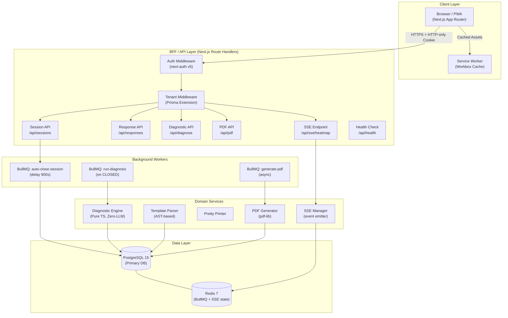
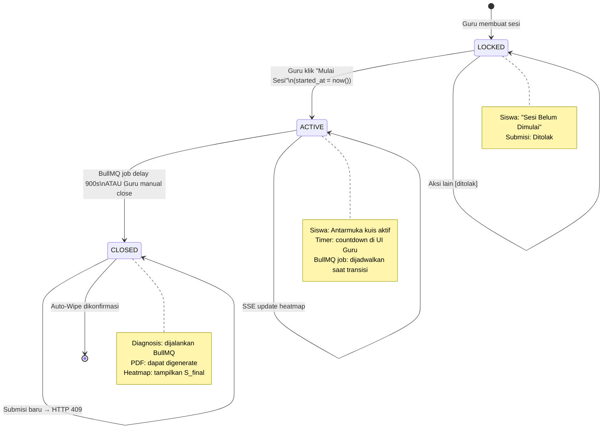
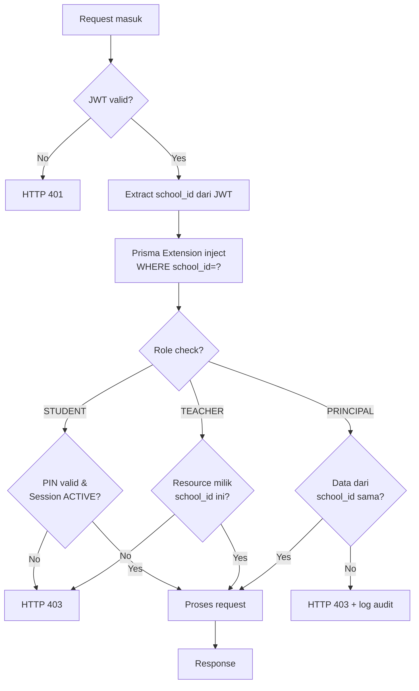
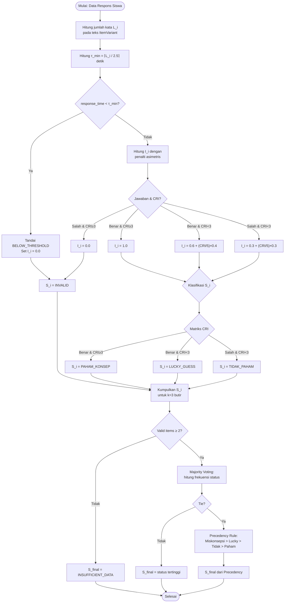
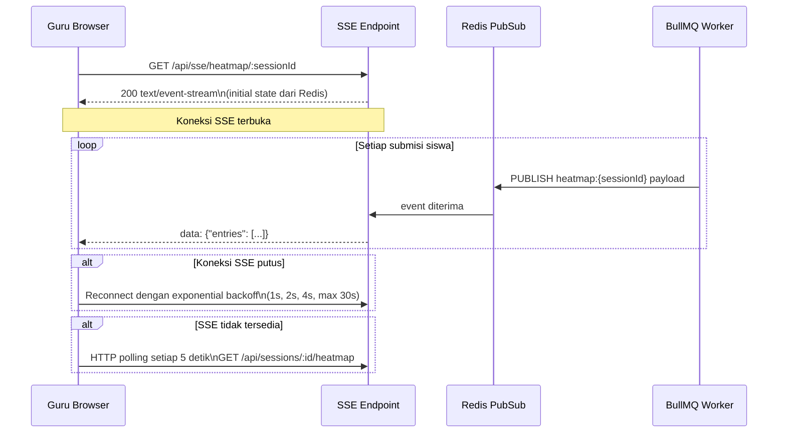
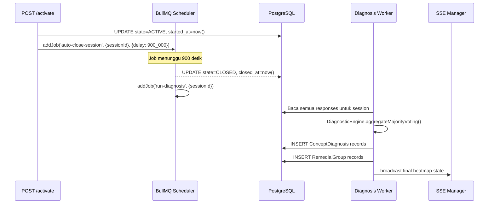

# Design Document — RemediAide

## Overview

RemediAide adalah aplikasi web/PWA fullstack yang mengotomasi diagnosis status kognitif siswa
menggunakan Certainty of Response Index (CRI) berbasis aturan deterministik (Zero-LLM). Sistem
ini dirancang dengan prinsip **Privacy by Design** sesuai UU No. 27 Tahun 2022 tentang
Perlindungan Data Pribadi (UU PDP), dan mengimplementasikan arsitektur **Shared-Schema
Multi-Tenancy** untuk mendukung ekspansi antar sekolah tanpa perubahan skema database.

### Stack Teknologi

| Layer | Teknologi |
|-------|-----------|
| Frontend & BFF | Next.js 14+ App Router, TypeScript strict |
| Styling | Tailwind CSS + shadcn/ui |
| Database | PostgreSQL 15 + Prisma ORM (Client Extension untuk RLS) |
| Queue & Scheduler | BullMQ + Redis 7 |
| Real-time | Server-Sent Events (SSE) + HTTP polling fallback |
| PDF Generation | pdf-lib (pure TS, no native deps) |
| PWA | next-pwa (Workbox), service worker caching |
| Testing | Vitest (unit + PBT via fast-check), Playwright (E2E) |
| Auth | next-auth v5 (credentials + session cookie HTTP-only) |

### Prinsip Arsitektur

- **Zero-LLM Diagnosis**: Seluruh klasifikasi kognitif menggunakan rule-based decision tree deterministik
- **Shared-Schema Multi-Tenancy**: Satu schema database, isolasi per `school_id` via Prisma Extension
- **Privacy by Default**: Auto-Wipe data respons mentah post-remediasi, anonimisasi label siswa
- **Offline-First PWA**: Service worker cache antarmuka kuis siswa untuk operasi tanpa koneksi
- **Server-Authoritative State**: Semua validasi dan state transition terjadi di sisi server


---

## Architecture

### Diagram Arsitektur Sistem Keseluruhan




### State Machine Exit Ticket



### Alur Request Multi-Tenant

Setiap request dari Guru atau Kepala Sekolah melewati Prisma Client Extension yang secara otomatis
menyuntikkan filter `school_id` pada semua query. Siswa diautentikasi via PIN sesi sementara
tanpa akun permanen.

```
Request → Auth Middleware (next-auth) → Tenant Context Extraction (JWT claim: school_id)
       → Prisma Extension (auto-inject WHERE school_id = ?) → Database Query
```


---

## Components and Interfaces

### 1. Diagnostic Engine

Komponen inti yang mengimplementasikan seluruh algoritma klasifikasi CRI. Bersifat **pure
function** tanpa side effects — menerima data respons dan mengembalikan hasil diagnosis.

```typescript
// src/lib/diagnostic/engine.ts

export type CognitiveStatus =
  | 'PAHAM_KONSEP'
  | 'LUCKY_GUESS'
  | 'MISKONSEPSI'
  | 'TIDAK_PAHAM'
  | 'INVALID'
  | 'INSUFFICIENT_DATA';

export interface ResponseInput {
  itemId: string;
  isCorrect: boolean;
  criValue: number;        // 0–5 integer
  responseTimeMs: number;  // waktu respons dalam milidetik
  tauMinMs: number;        // threshold waktu baca dalam milidetik
}

export interface DiagnosisResult {
  itemId: string;
  status: CognitiveStatus;
  integrityIndex: number;  // I_i ∈ [0.0, 1.0]
  isBelowThreshold: boolean;
  auditTrail: {
    criNormalized: number;
    timeRatio: number;
    classificationRule: string;
  };
}

export interface AggregationResult {
  finalStatus: CognitiveStatus;
  votingTally: Record<CognitiveStatus, number>;
  tiebreakerApplied: boolean;
  validItemCount: number;
}

// Interface utama Diagnostic Engine
export interface IDiagnosticEngine {
  calculateTauMin(wordCount: number): number;
  countWords(text: string): number;
  calculateIntegrityIndex(input: ResponseInput): number;
  classifyPerItem(input: ResponseInput): DiagnosisResult;
  aggregateMajorityVoting(results: DiagnosisResult[]): AggregationResult;
}
```

### 2. Template Parser & Pretty Printer (Isomorphic Pool)

```typescript
// src/lib/template/types.ts

export type ASTNode =
  | { type: 'text'; value: string }
  | { type: 'placeholder'; name: string };

export interface TemplateAST {
  nodes: ASTNode[];
  variables: VariableDefinition[];
  constraints: ConstraintExpression[];
}

export interface VariableDefinition {
  name: string;
  min: number;
  max: number;
}

export interface ConstraintExpression {
  expression: string;  // e.g., "a < b", "lcm(a,b) <= 100"
  rawText: string;
}

export interface ITemplateParser {
  parse(templateText: string): Result<TemplateAST, ParseError>;
}

export interface ITemplatePrettyPrinter {
  print(ast: TemplateAST): string;
}

export interface ITemplateRenderer {
  render(ast: TemplateAST, values: Record<string, number>): string;
}
```

### 3. SSE Manager

```typescript
// src/lib/sse/manager.ts

export interface HeatmapEntry {
  anonymousLabel: string;
  submissionStatus: 'NOT_SUBMITTED' | 'PARTIAL' | 'COMPLETE';
  cognitiveStatus?: CognitiveStatus; // hanya setelah CLOSED
}

export interface ISSEManager {
  subscribe(sessionId: string, clientId: string, res: Response): void;
  unsubscribe(sessionId: string, clientId: string): void;
  broadcast(sessionId: string, payload: HeatmapEntry[]): void;
  getLastState(sessionId: string): HeatmapEntry[];
}
```


### 4. BullMQ Workers

```typescript
// src/workers/index.ts

// Worker 1: auto-close-session — delay 900s dari aktivasi
// Dipicu: POST /api/sessions/:id/activate
// Job payload: { sessionId: string, schoolId: string }
// Action: UPDATE sessions SET state='CLOSED', closed_at=now()
//         → enqueue run-diagnosis job

// Worker 2: run-diagnosis — dijalankan setelah sesi CLOSED
// Job payload: { sessionId: string }
// Action: Panggil DiagnosticEngine.aggregateMajorityVoting per siswa
//         → simpan ConceptDiagnosis records
//         → broadcast SSE final state

// Worker 3: generate-pdf — async dari request Guru
// Job payload: { sessionId: string, groupIds: string[], teacherId: string }
// Action: Render PDF via pdf-lib → simpan file → return URL download
```

### 5. Prisma Client Extension (Tenant Isolation)

```typescript
// src/lib/db/tenant-extension.ts

// Extension yang menyuntikkan school_id pada setiap query
// Model yang terkena: Teacher, Class, Student, Test, Question, Response, ConceptDiagnosis
// Implementasi: Prisma.$extends({ query: { $allModels: { findMany, findFirst, ... } } })
// Sumber school_id: AsyncLocalStorage (di-set oleh Auth Middleware dari JWT claim)
```

---

## Data Models

### ERD Database

```mermaid
erDiagram
    School {
        uuid id PK
        string name
        string subdomain UK
        datetime created_at
    }

    Teacher {
        uuid id PK
        uuid school_id FK
        string email UK
        string name
        string password_hash
        enum role "TEACHER|PRINCIPAL"
        datetime created_at
    }

    Class {
        uuid id PK
        uuid school_id FK
        uuid teacher_id FK
        string name
        string grade
        int academic_year
        datetime created_at
    }

    Student {
        uuid id PK
        uuid class_id FK
        uuid school_id FK
        string anonymous_label UK
        datetime created_at
    }

    Test {
        uuid id PK
        uuid school_id FK
        uuid class_id FK
        uuid teacher_id FK
        string topic
        int duration_seconds
        datetime created_at
    }

    Question {
        uuid id PK
        uuid test_id FK
        uuid school_id FK
        string template_text
        jsonb template_ast
        jsonb variable_definitions
        jsonb constraints
        int item_order
        datetime created_at
    }

    ItemVariant {
        uuid id PK
        uuid question_id FK
        jsonb variable_values
        string rendered_text
        jsonb rendered_options
        string correct_option_key
        int tau_min_seconds
        enum calibration_status "expert_estimated|calibrating|validated"
        boolean has_potential_issue
        jsonb usage_stats
        datetime created_at
    }

    SessionPin {
        uuid id PK
        uuid test_id FK
        uuid school_id FK
        string pin_code UK
        enum state "LOCKED|ACTIVE|CLOSED"
        datetime started_at
        datetime closed_at
        boolean pin_fallback_enabled
        datetime created_at
    }

    Response {
        uuid id PK
        uuid session_pin_id FK
        uuid student_id FK
        uuid item_variant_id FK
        uuid school_id FK
        string chosen_option_key
        int cri_value
        int response_time_ms
        decimal integrity_index
        boolean is_below_threshold
        enum per_item_status "PAHAM_KONSEP|LUCKY_GUESS|MISKONSEPSI|TIDAK_PAHAM|INVALID"
        datetime submitted_at
    }

    ConceptDiagnosis {
        uuid id PK
        uuid session_pin_id FK
        uuid student_id FK
        uuid question_id FK
        uuid school_id FK
        enum final_status "PAHAM_KONSEP|LUCKY_GUESS|MISKONSEPSI|TIDAK_PAHAM|INSUFFICIENT_DATA"
        jsonb voting_tally
        boolean tiebreaker_applied
        int valid_item_count
        boolean manually_overridden
        datetime diagnosed_at
    }

    RemedialGroup {
        uuid id PK
        uuid session_pin_id FK
        uuid school_id FK
        enum cognitive_status "PAHAM_KONSEP|LUCKY_GUESS|MISKONSEPSI|TIDAK_PAHAM|INSUFFICIENT_DATA"
        jsonb member_labels
        text prescription
        datetime created_at
    }

    CalibrationConfig {
        uuid id PK
        int min_sessions_for_calibrating
        int min_responses_for_calibrating
        int min_sessions_for_validated
        int min_responses_for_validated
        decimal max_std_dev_for_validated
        datetime updated_at
    }

    AutoWipeLog {
        uuid id PK
        uuid session_pin_id FK
        uuid confirmed_by FK
        uuid school_id FK
        int records_deleted
        boolean success
        string error_message
        datetime executed_at
    }

    School ||--o{ Teacher : "has"
    School ||--o{ Class : "has"
    School ||--o{ Student : "enrolled in"
    Teacher ||--o{ Class : "teaches"
    Class ||--o{ Student : "contains"
    Class ||--o{ Test : "has"
    Test ||--o{ Question : "contains"
    Question ||--o{ ItemVariant : "has variants"
    Test ||--o{ SessionPin : "creates"
    SessionPin ||--o{ Response : "collects"
    SessionPin ||--o{ ConceptDiagnosis : "produces"
    SessionPin ||--o{ RemedialGroup : "generates"
    SessionPin ||--o| AutoWipeLog : "has"
    Student ||--o{ Response : "submits"
    ItemVariant ||--o{ Response : "used in"
    Student ||--o{ ConceptDiagnosis : "diagnosed as"
    Teacher ||--o{ AutoWipeLog : "confirms"
```


### Prisma Schema (lengkap)

```prisma
// prisma/schema.prisma

model School {
  id         String    @id @default(uuid())
  name       String
  subdomain  String    @unique
  createdAt  DateTime  @default(now()) @map("created_at")
  teachers   Teacher[]
  classes    Class[]
  students   Student[]
}

model Teacher {
  id           String    @id @default(uuid())
  schoolId     String    @map("school_id")
  email        String    @unique
  name         String
  passwordHash String    @map("password_hash")
  role         TeacherRole @default(TEACHER)
  createdAt    DateTime  @default(now()) @map("created_at")
  school       School    @relation(fields: [schoolId], references: [id])
  classes      Class[]
  tests        Test[]
  autoWipeLogs AutoWipeLog[]
  @@map("teachers")
}

model Class {
  id           String    @id @default(uuid())
  schoolId     String    @map("school_id")
  teacherId    String    @map("teacher_id")
  name         String
  grade        String
  academicYear Int       @map("academic_year")
  createdAt    DateTime  @default(now()) @map("created_at")
  school       School    @relation(fields: [schoolId], references: [id])
  teacher      Teacher   @relation(fields: [teacherId], references: [id])
  students     Student[]
  tests        Test[]
  @@map("classes")
}

model Student {
  id             String    @id @default(uuid())
  classId        String    @map("class_id")
  schoolId       String    @map("school_id")
  anonymousLabel String    @unique @map("anonymous_label")
  createdAt      DateTime  @default(now()) @map("created_at")
  class          Class     @relation(fields: [classId], references: [id])
  school         School    @relation(fields: [schoolId], references: [id])
  responses      Response[]
  diagnoses      ConceptDiagnosis[]
  @@map("students")
}

model Test {
  id              String    @id @default(uuid())
  schoolId        String    @map("school_id")
  classId         String    @map("class_id")
  teacherId       String    @map("teacher_id")
  topic           String
  durationSeconds Int       @default(900) @map("duration_seconds")
  createdAt       DateTime  @default(now()) @map("created_at")
  school          School    @relation(fields: [schoolId], references: [id])
  class           Class     @relation(fields: [classId], references: [id])
  teacher         Teacher   @relation(fields: [teacherId], references: [id])
  questions       Question[]
  sessions        SessionPin[]
  @@map("tests")
}
```


```prisma
model Question {
  id                 String    @id @default(uuid())
  testId             String    @map("test_id")
  schoolId           String    @map("school_id")
  templateText       String    @map("template_text")
  templateAst        Json      @map("template_ast")
  variableDefinitions Json     @map("variable_definitions")
  constraints        Json
  itemOrder          Int       @map("item_order")
  createdAt          DateTime  @default(now()) @map("created_at")
  test               Test      @relation(fields: [testId], references: [id])
  variants           ItemVariant[]
  diagnoses          ConceptDiagnosis[]
  @@map("questions")
}

model ItemVariant {
  id                String            @id @default(uuid())
  questionId        String            @map("question_id")
  variableValues    Json              @map("variable_values")
  renderedText      String            @map("rendered_text")
  renderedOptions   Json              @map("rendered_options")
  correctOptionKey  String            @map("correct_option_key")
  tauMinSeconds     Int               @map("tau_min_seconds")
  calibrationStatus CalibrationStatus @default(EXPERT_ESTIMATED) @map("calibration_status")
  hasPotentialIssue Boolean           @default(false) @map("has_potential_issue")
  usageStats        Json              @default("{}") @map("usage_stats")
  createdAt         DateTime          @default(now()) @map("created_at")
  question          Question          @relation(fields: [questionId], references: [id])
  responses         Response[]
  @@map("item_variants")
}

model SessionPin {
  id                  String      @id @default(uuid())
  testId              String      @map("test_id")
  schoolId            String      @map("school_id")
  pinCode             String      @unique @map("pin_code")
  state               SessionState @default(LOCKED)
  startedAt           DateTime?   @map("started_at")
  closedAt            DateTime?   @map("closed_at")
  pinFallbackEnabled  Boolean     @default(false) @map("pin_fallback_enabled")
  createdAt           DateTime    @default(now()) @map("created_at")
  test                Test        @relation(fields: [testId], references: [id])
  responses           Response[]
  diagnoses           ConceptDiagnosis[]
  remedialGroups      RemedialGroup[]
  autoWipeLog         AutoWipeLog?
  @@map("session_pins")
}

model Response {
  id              String          @id @default(uuid())
  sessionPinId    String          @map("session_pin_id")
  studentId       String          @map("student_id")
  itemVariantId   String          @map("item_variant_id")
  schoolId        String          @map("school_id")
  chosenOptionKey String          @map("chosen_option_key")
  criValue        Int             @map("cri_value")
  responseTimeMs  Int             @map("response_time_ms")
  integrityIndex  Decimal         @map("integrity_index") @db.Decimal(4, 3)
  isBelowThreshold Boolean        @default(false) @map("is_below_threshold")
  perItemStatus   PerItemStatus   @map("per_item_status")
  submittedAt     DateTime        @default(now()) @map("submitted_at")
  session         SessionPin      @relation(fields: [sessionPinId], references: [id])
  student         Student         @relation(fields: [studentId], references: [id])
  itemVariant     ItemVariant     @relation(fields: [itemVariantId], references: [id])
  @@unique([sessionPinId, studentId, itemVariantId])
  @@map("responses")
}

model ConceptDiagnosis {
  id                  String        @id @default(uuid())
  sessionPinId        String        @map("session_pin_id")
  studentId           String        @map("student_id")
  questionId          String        @map("question_id")
  schoolId            String        @map("school_id")
  finalStatus         FinalStatus   @map("final_status")
  votingTally         Json          @map("voting_tally")
  tiebreakerApplied   Boolean       @default(false) @map("tiebreaker_applied")
  validItemCount      Int           @map("valid_item_count")
  manuallyOverridden  Boolean       @default(false) @map("manually_overridden")
  diagnosedAt         DateTime      @default(now()) @map("diagnosed_at")
  session             SessionPin    @relation(fields: [sessionPinId], references: [id])
  student             Student       @relation(fields: [studentId], references: [id])
  question            Question      @relation(fields: [questionId], references: [id])
  @@unique([sessionPinId, studentId, questionId])
  @@map("concept_diagnoses")
}

enum TeacherRole    { TEACHER PRINCIPAL }
enum SessionState   { LOCKED ACTIVE CLOSED }
enum CalibrationStatus { EXPERT_ESTIMATED CALIBRATING VALIDATED }
enum PerItemStatus  { PAHAM_KONSEP LUCKY_GUESS MISKONSEPSI TIDAK_PAHAM INVALID }
enum FinalStatus    { PAHAM_KONSEP LUCKY_GUESS MISKONSEPSI TIDAK_PAHAM INSUFFICIENT_DATA }
```


---

## API Design

### Route Handlers (Next.js App Router)

#### Authentication & Session

| Method | Path | Deskripsi | Auth |
|--------|------|-----------|------|
| POST | `/api/auth/login` | Login Guru/Kepala Sekolah (credentials) | Public |
| POST | `/api/auth/logout` | Invalidate session token | Authenticated |
| POST | `/api/student/join` | Join Exit Ticket dengan PIN | Public |

#### Session Management

| Method | Path | Deskripsi | Auth |
|--------|------|-----------|------|
| GET | `/api/sessions` | List sesi milik Guru | TEACHER |
| POST | `/api/sessions` | Buat sesi baru | TEACHER |
| GET | `/api/sessions/:id` | Detail sesi | TEACHER |
| POST | `/api/sessions/:id/activate` | Aktifkan sesi (LOCKED→ACTIVE) | TEACHER |
| POST | `/api/sessions/:id/close` | Tutup sesi manual (ACTIVE→CLOSED) | TEACHER |

#### Student Quiz

| Method | Path | Deskripsi | Auth |
|--------|------|-----------|------|
| GET | `/api/sessions/:id/quiz` | Ambil soal yang ditugaskan ke siswa | STUDENT_PIN |
| POST | `/api/responses` | Submit respons per-butir | STUDENT_PIN |

#### Diagnosis & Analytics

| Method | Path | Deskripsi | Auth |
|--------|------|-----------|------|
| GET | `/api/sessions/:id/diagnoses` | Hasil diagnosis per siswa | TEACHER |
| GET | `/api/sessions/:id/groups` | Kelompok remedial | TEACHER |
| POST | `/api/sessions/:id/groups/:groupId/override` | Override manual kelompok | TEACHER |

#### Question Builder

| Method | Path | Deskripsi | Auth |
|--------|------|-----------|------|
| GET | `/api/tests/:testId/questions` | List soal | TEACHER |
| POST | `/api/tests/:testId/questions` | Buat soal + generate variants | TEACHER |
| PUT | `/api/questions/:id` | Update template soal | TEACHER |
| GET | `/api/questions/:id/variants` | List ItemVariant | TEACHER |
| PUT | `/api/variants/:id/calibration` | Update CalibrationStatus | TEACHER |

#### PDF & Export

| Method | Path | Deskripsi | Auth |
|--------|------|-----------|------|
| POST | `/api/sessions/:id/pdf` | Request generate LKPD-KK | TEACHER |
| GET | `/api/sessions/:id/export/csv` | Export CSV | TEACHER |

#### Real-time & Monitoring

| Method | Path | Deskripsi | Auth |
|--------|------|-----------|------|
| GET | `/api/sse/heatmap/:sessionId` | SSE stream heatmap | TEACHER |
| GET | `/api/health` | Health check (DB + Redis + BullMQ) | Public |

#### Principal Dashboard

| Method | Path | Deskripsi | Auth |
|--------|------|-----------|------|
| GET | `/api/principal/overview` | Agregat sekolah | PRINCIPAL |
| GET | `/api/principal/classes` | Perbandingan antar kelas | PRINCIPAL |

#### Auto-Wipe

| Method | Path | Deskripsi | Auth |
|--------|------|-----------|------|
| POST | `/api/sessions/:id/wipe/preview` | Preview data yang akan dihapus | TEACHER |
| POST | `/api/sessions/:id/wipe/confirm` | Konfirmasi wipe (step 2) | TEACHER |


### Response Format Standar

```typescript
// Semua API mengembalikan format konsisten
type ApiResponse<T> =
  | { success: true; data: T }
  | { success: false; error: { code: string; message: string } };

// Error codes
// AUTH_REQUIRED       — HTTP 401
// FORBIDDEN           — HTTP 403
// SESSION_CLOSED      — HTTP 409
// DUPLICATE_RESPONSE  — HTTP 409
// VALIDATION_ERROR    — HTTP 422
// INTERNAL_ERROR      — HTTP 500
```

---

## Security Architecture

### Time-Window State Machine & Tenant Isolation



### PIN Fallback Security

- PIN sesi: 6 digit acak, valid hanya selama state `ACTIVE`
- Rate limiting: 3 percobaan salah → exponential backoff (1s, 2s, 4s, ...)
- PIN fallback: maksimal 5 pemulihan per siswa per sesi
- Pada state `CLOSED` atau sisa waktu <60 detik: pemulihan ditolak

### Anti-Cheat Server-Side Validation

Setiap submisi respons divalidasi server-side:
1. `item_id` yang dikirim cocok dengan ItemVariant yang ditugaskan ke siswa tersebut
2. Session state masih `ACTIVE`
3. Siswa belum pernah submit untuk `item_id` yang sama di sesi ini
4. Response time ≥ τ_min (jika tidak, flag `BELOW_THRESHOLD`)
5. Answer key tidak pernah dikirim ke klien

---

## Core Algorithm — CRI Diagnostic Engine

### Diagram Alur Diagnostic Engine




### Formula Lengkap

**1. Kalkulasi τ_min (Ambang Waktu Baca Logis)**

```
v = 2.5 kata/detik  (150 kata/menit)
L_i = jumlah kata pada teks soal i (dinormalisasi: huruf kecil, tanda baca dihapus)
τ_min,i = ⌈L_i / v⌉  (ceiling ke detik)
```

**2. Kalkulasi I_i (Indeks Integritas Respons)**

```
IF response_time_ms < τ_min,i × 1000:
    I_i = 0.0  (BELOW_THRESHOLD)
ELSE IF isCorrect AND cri >= 3:
    I_i = 1.0
ELSE IF isCorrect AND cri < 3:
    I_i = 0.6 + (cri / 5) × 0.4
ELSE IF NOT isCorrect AND cri >= 3:
    I_i = 0.0
ELSE:  # NOT isCorrect AND cri < 3
    I_i = 0.3 + (cri / 5) × 0.3

// Invariant: I_i ∈ [0.0, 1.0]
```

**3. Klasifikasi S_i (Status Kognitif Per-Butir)**

```
IF I_i = 0.0 OR BELOW_THRESHOLD:
    S_i = INVALID
ELSE:
    | isCorrect | cri >= 3 | S_i           |
    |-----------|----------|---------------|
    | true      | true     | PAHAM_KONSEP  |
    | true      | false    | LUCKY_GUESS   |
    | false     | true     | MISKONSEPSI   |
    | false     | false    | TIDAK_PAHAM   |
```

**4. Majority Voting dengan Precedency Rule**

```
validStatuses = [S_i for each item where S_i != INVALID]

IF len(validStatuses) < 2:
    S_final = INSUFFICIENT_DATA
ELSE:
    tally = count frequency per status
    maxFreq = max(tally.values())
    candidates = [s for s, f in tally if f == maxFreq]

    IF len(candidates) == 1:
        S_final = candidates[0]
    ELSE:  # Tie
        PRECEDENCY = [MISKONSEPSI, LUCKY_GUESS, TIDAK_PAHAM, PAHAM_KONSEP]
        S_final = first(s for s in PRECEDENCY if s in candidates)
```

---

## Real-Time Layer

### SSE Heatmap Architecture



### BullMQ Auto-Release Flow




---

## PWA Architecture

### Service Worker Caching Strategy

```
// next-pwa (Workbox) configuration

Cache Strategy per asset type:

1. Shell Cache (CacheFirst, max-age 30 hari):
   - /_next/static/** (JS, CSS bundles)
   - /fonts/**
   - /icons/**

2. API Cache (NetworkFirst, timeout 3s, fallback to cache):
   - /api/sessions/:id/quiz  — soal yang ditugaskan ke siswa

3. Background Sync (untuk submisi respons saat offline):
   - POST /api/responses — disimpan di IndexedDB, sync saat online kembali

4. No-cache (selalu network):
   - /api/sse/**
   - /api/sessions/:id/activate
   - /api/sessions/:id/close
```

### PWA Manifest

```json
{
  "name": "RemediAide",
  "short_name": "RemediAide",
  "start_url": "/student",
  "display": "standalone",
  "background_color": "#ffffff",
  "theme_color": "#2563eb",
  "orientation": "portrait",
  "icons": [
    { "src": "/icons/icon-192.png", "sizes": "192x192", "type": "image/png" },
    { "src": "/icons/icon-512.png", "sizes": "512x512", "type": "image/png" }
  ]
}
```

### Offline-First Flow untuk Siswa

1. Siswa install PWA → shell cache tersimpan
2. Siswa buka Exit Ticket → soal di-cache NetworkFirst
3. Koneksi putus → submisi disimpan di IndexedDB via Background Sync
4. Koneksi pulih → Background Sync kirim respons yang tertunda ke server
5. Server memvalidasi ulang state sesi sebelum menerima respons yang tertunda

---

## PDF Generation Pipeline

### LKPD-KK PDF Structure

```mermaid
flowchart LR
    REQ[POST /api/sessions/:id/pdf] --> QUEUE[BullMQ: generate-pdf job]
    QUEUE --> DATA[Ambil data:\nConceptDiagnosis + RemedialGroup]
    DATA --> RENDER{Render per\nkelompok kognitif}
    RENDER --> G1[PDF Paham Konsep\n+ soal pengayaan]
    RENDER --> G2[PDF Lucky Guess\n+ latihan isomorfik]
    RENDER --> G3[PDF Miskonsepsi\n+ aktivitas Cognitive Conflict]
    RENDER --> G4[PDF Tidak Paham\n+ scaffolding Generatif]
    G1 & G2 & G3 & G4 --> QR[Embed QR Code\n→ URL Exit Ticket sesi]
    QR --> META[Header: ID sesi, tanggal,\nnama Guru, topik materi]
    META --> SAVE[Simpan PDF ke storage\n(filesystem / object storage)]
    SAVE --> URL[Return download URL ke klien]
```

### pdf-lib Implementation Pattern

```typescript
// src/lib/pdf/lkpd-generator.ts

export async function generateLKPDGroup(params: {
  groupStatus: FinalStatus;
  members: string[];          // anonymousLabels
  prescription: string;
  exerciseVariants: ItemVariant[];
  sessionMeta: SessionMeta;
  qrCodeDataUrl: string;
}): Promise<Uint8Array> {
  const pdfDoc = await PDFDocument.create();
  const page = pdfDoc.addPage(PageSizes.A4);
  // margin: 2cm = ~56.7 pt
  // Header: sessionMeta
  // Body: prescription text + member list + exercises
  // Footer: QR code
  return await pdfDoc.save();
}
```

### QR Code Generation

- Library: `qrcode` (pure JS)
- Content: `https://{subdomain}.remediaide.app/join/{sessionPin.pinCode}`
- Format: Data URL PNG untuk embed ke pdf-lib
- Static QR: tidak bergantung koneksi saat cetak


---

## Correctness Properties

*A property is a characteristic or behavior that should hold true across all valid executions of a system — essentially, a formal statement about what the system should do. Properties serve as the bridge between human-readable specifications and machine-verifiable correctness guarantees.*

Semua properties di bawah ini diimplementasikan menggunakan **fast-check** (TypeScript PBT library) dengan minimum 100 iterasi per property.

---

### Property 1: Deterministic Classification Idempotence

*For any* valid response (isCorrect ∈ {true, false}, criValue ∈ [0..5]) yang tidak memiliki flag `BELOW_THRESHOLD`, memanggil `classifyPerItem` dua kali dengan input yang sama HARUS selalu menghasilkan status kognitif yang identik.

```
∀ (isCorrect, criValue, responseTime ≥ tauMin),
  classify(input) === classify(input)
```

**Validates: Requirements 6.3**

---

### Property 2: I_i Bounds Invariant

*For any* kombinasi input respons yang valid (jawaban ∈ {true, false}, CRI ∈ [0..5], responseTime ≥ 0), hasil `calculateIntegrityIndex` HARUS selalu berada dalam rentang [0.0, 1.0].

```
∀ input respons,
  0.0 ≤ calculateIntegrityIndex(input) ≤ 1.0
```

**Validates: Requirements 5.4**

---

### Property 3: BELOW_THRESHOLD Always Produces I_i = 0.0

*For any* respons di mana `responseTimeMs < tauMinMs`, `calculateIntegrityIndex` HARUS mengembalikan tepat 0.0, terlepas dari nilai jawaban dan CRI.

```
∀ responseTime < tauMin, ∀ (isCorrect, cri),
  calculateIntegrityIndex({..., responseTime, tauMin}) === 0.0
```

**Validates: Requirements 5.2**

---

### Property 4: INVALID Status for BELOW_THRESHOLD Responses

*For any* respons yang memiliki `responseTimeMs < tauMinMs`, `classifyPerItem` HARUS mengembalikan status `INVALID`.

```
∀ response dengan responseTime < tauMin,
  classifyPerItem(response).status === 'INVALID'
```

**Validates: Requirements 6.2**

---

### Property 5: Template Parser Round-Trip

*For any* teks template soal yang valid (mengandung placeholder `{{var}}` yang terdefinisi, tidak mengandung injection), proses `parse → prettyPrint → parse` HARUS menghasilkan AST yang deep-equal dengan hasil `parse` pertama.

```
∀ validTemplateText,
  deepEqual(parse(prettyPrint(parse(text))), parse(text))
```

**Validates: Requirements 17.4, 18.4**

---

### Property 6: Majority Voting Always Returns Single Status

*For any* array tiga status kognitif dari butir yang valid (`[S_1, S_2, S_3]` ∈ {PAHAM_KONSEP, LUCKY_GUESS, MISKONSEPSI, TIDAK_PAHAM}³), `aggregateMajorityVoting` HARUS mengembalikan tepat satu `S_final` yang terdefinisi (bukan array, bukan undefined).

```
∀ [S_1, S_2, S_3] ∈ valid_statuses^3,
  typeof aggregateMajorityVoting([S1, S2, S3]).finalStatus === 'string'
  AND finalStatus !== 'INSUFFICIENT_DATA'
```

**Validates: Requirements 7.1, 7.2, 7.3**

---

### Property 7: Precedency Rule Tie-Breaking Determinism

*For any* tie situation (dua atau lebih status kognitif dengan frekuensi sama), `aggregateMajorityVoting` HARUS selalu memenangkan status dengan prioritas tertinggi dalam urutan: MISKONSEPSI > LUCKY_GUESS > TIDAK_PAHAM > PAHAM_KONSEP.

```
∀ tie_input di mana count(MISKONSEPSI) = count(LUCKY_GUESS),
  aggregateMajorityVoting(tie_input).finalStatus === 'MISKONSEPSI'
```

**Validates: Requirements 7.3**

> **Property Reflection**: Property 6 dan Property 7 tidak redundant — Property 6 memverifikasi output selalu tunggal untuk *semua* input, sedangkan Property 7 secara spesifik memverifikasi *correctness* tie-breaking. Keduanya saling melengkapi.

---

### Property 8: ItemVariant Constraint Satisfaction

*For any* ItemVariant yang dihasilkan oleh generator dari template dengan constraint relasional (contoh: `a < b`), SETIAP variant HARUS memenuhi SEMUA constraint yang didefinisikan.

```
∀ ItemVariant v ∈ generateVariants(template, constraints),
  ∀ constraint c ∈ constraints,
    evaluate(c, v.variableValues) === true
```

**Validates: Requirements 10.2, 10.3**

---

### Property 9: State Machine Irreversibility

*For any* urutan event pada sesi Exit Ticket, transisi mundur (CLOSED→ACTIVE, ACTIVE→LOCKED, CLOSED→LOCKED) HARUS selalu menghasilkan error atau mempertahankan state saat ini — tidak pernah berhasil melakukan transisi mundur.

```
∀ state ∈ {LOCKED, ACTIVE, CLOSED},
  ∀ reverseEvent ∈ invalid_transitions[state],
    applyTransition(state, reverseEvent) throws Error || returns same state
```

**Validates: Requirements 1.7**

---

### Property 10: Tenant Isolation in Query Results

*For any* query database yang dieksekusi melalui Prisma Client Extension dengan `school_id = X`, SETIAP record dalam hasil HARUS memiliki `school_id = X` (tidak ada kebocoran data antar-tenant).

```
∀ query Q dengan school_id = X,
  ∀ record r ∈ execute(Q),
    r.school_id === X
```

**Validates: Requirements 3.6, 14.3**

---

### Property 11: τ_min Ceiling Invariant

*For any* jumlah kata `L_i ≥ 1`, `calculateTauMin(L_i)` HARUS mengembalikan bilangan bulat positif dan HARUS ≥ `L_i / 2.5` (tidak pernah di bawah ambang teoretis).

```
∀ L_i ∈ [1, ∞),
  τ = calculateTauMin(L_i)
  τ ∈ ℤ+ AND τ >= Math.ceil(L_i / 2.5)
```

**Validates: Requirements 4.1, 4.3**

---

### Property 12: Invalid Template Rejection with Descriptive Error

*For any* template yang mengandung placeholder tidak terdefinisi ATAU constraint yang mereferensikan variabel tidak ada ATAU konstruksi injection (HTML tags, script tags), `Template_Parser.parse()` HARUS mengembalikan `Result.Error` dengan pesan yang mengandung identifikasi masalah spesifik — tidak pernah crash atau return partial result.

```
∀ invalidTemplate,
  result = parse(invalidTemplate)
  result.isError() === true AND result.message.length > 0
```

**Validates: Requirements 17.2, 17.5**


---

## Error Handling

### Strategi Error per Layer

| Layer | Strategi |
|-------|---------|
| API Route Handler | try-catch → return `{ success: false, error: { code, message } }` |
| BullMQ Worker | retry 3x dengan exponential backoff; dead-letter queue setelah 3 gagal |
| Diagnostic Engine | Result<T, E> pattern; tidak pernah throw di fungsi murni |
| Template Parser | Result<AST, ParseError> pattern |
| PDF Generator | Structured error logging; pesan user-friendly tanpa stack trace |
| Auto-Wipe | Transaksional penuh; rollback pada kegagalan parsial |

### Error Codes dan HTTP Status

```typescript
export const ErrorCode = {
  // 4xx — Client errors
  AUTH_REQUIRED:       { http: 401, message: 'Authentication required' },
  FORBIDDEN:           { http: 403, message: 'Access denied' },
  SESSION_NOT_FOUND:   { http: 404, message: 'Session not found' },
  SESSION_CLOSED:      { http: 409, message: 'Session is already closed' },
  DUPLICATE_RESPONSE:  { http: 409, message: 'Response already submitted' },
  VALIDATION_ERROR:    { http: 422, message: 'Validation failed' },
  RATE_LIMITED:        { http: 429, message: 'Too many attempts' },

  // 5xx — Server errors
  INTERNAL_ERROR:      { http: 500, message: 'Internal server error' },
  PDF_GENERATION_FAILED: { http: 500, message: 'PDF generation failed' },
  WIPE_FAILED:         { http: 500, message: 'Auto-wipe failed, no data was deleted' },
} as const;
```

### Sensitive Data Masking dalam Logs

Fields yang di-mask sebelum logging:
- `pinCode` → `"****"`
- `passwordHash` → `"[REDACTED]"`
- `chosenOptionKey` → `"[MASKED]"` (dalam log error, bukan audit log)
- Request body untuk endpoint PIN join → seluruh body di-mask

---

## Testing Strategy

### Dual Testing Approach

RemediAide menggunakan dua lapisan testing yang saling melengkapi:

1. **Unit Tests + Property-Based Tests** (Vitest + fast-check): memverifikasi logika domain murni
2. **Integration + E2E Tests** (Vitest integration + Playwright): memverifikasi alur end-to-end

### Unit Tests (Vitest)

**Target komponen:**
- `DiagnosticEngine` — semua fungsi kalkulasi dan klasifikasi
- `TemplateParser` — parsing, validation, error handling
- `TemplatePrettyPrinter` — formatting, round-trip
- `VariantGenerator` — constraint satisfaction
- `MajorityVoting` — semua kombinasi tie dan normal

**Contoh struktur:**

```typescript
// src/lib/diagnostic/__tests__/engine.test.ts
describe('DiagnosticEngine', () => {
  describe('calculateTauMin', () => {
    it('returns ceiling of L_i / 2.5', () => { ... });
    it('handles single-word items', () => { ... });
  });
  describe('classifyPerItem', () => {
    it.each([
      [true, 3, 'PAHAM_KONSEP'],
      [true, 2, 'LUCKY_GUESS'],
      [false, 3, 'MISKONSEPSI'],  // setelah I_i check
      [false, 1, 'TIDAK_PAHAM'],
    ])('correct=%s, cri=%s → %s', (isCorrect, cri, expected) => { ... });
  });
});
```

### Property-Based Tests (fast-check)

Setiap property dalam bagian "Correctness Properties" diimplementasikan sebagai satu test PBT:

```typescript
// src/lib/diagnostic/__tests__/engine.property.test.ts
import * as fc from 'fast-check';

// Feature: remediaide, Property 1: Deterministic Classification Idempotence
test('Property 1: classify is idempotent', () => {
  fc.assert(
    fc.property(
      fc.record({
        isCorrect: fc.boolean(),
        criValue: fc.integer({ min: 0, max: 5 }),
        responseTimeMs: fc.integer({ min: 1000, max: 60000 }),
        tauMinMs: fc.integer({ min: 500, max: 30000 }),
      }).filter(r => r.responseTimeMs >= r.tauMinMs),
      (input) => {
        const result1 = engine.classifyPerItem(buildInput(input));
        const result2 = engine.classifyPerItem(buildInput(input));
        return result1.status === result2.status;
      }
    ),
    { numRuns: 100 }
  );
});
```

**Semua 12 properties** (Property 1–12) masing-masing diimplementasikan sebagai satu `test()` dengan `numRuns: 100`.

### Integration Tests (Vitest)

Menggunakan database test terisolasi (PostgreSQL test instance / in-memory SQLite via Prisma):

- Session lifecycle: LOCKED → ACTIVE → CLOSED via BullMQ
- Auto-Wipe: verifikasi data respons terhapus, agregat tetap ada
- Tenant isolation: query dengan school_id berbeda tidak bocor
- Response submission: duplicate rejection (HTTP 409)
- CalibrationStatus auto-upgrade threshold

### E2E Tests (Playwright)

```typescript
// tests/e2e/
// student-quiz.spec.ts — Alur siswa: join PIN → jawab soal → submit
// teacher-session.spec.ts — Guru: buat sesi → aktifkan → lihat heatmap
// remedial-pdf.spec.ts — Guru: generate LKPD-KK → download PDF
// principal-dashboard.spec.ts — Kepala Sekolah: akses agregat sekolah
```

### Testing di WCAG 2.1 AA

- Playwright `@axe-core/playwright` untuk automated accessibility scanning
- Manual check: contrast ratio, keyboard navigation, screen reader labels

### Performance Testing

- Load test: `k6` atau `artillery` — 300 concurrent users pada endpoint `/api/responses`
- Target P95 latency ≤ 200ms
- DiagnosticEngine S_final calculation ≤ 5 detik untuk 40 siswa


### File Structure Testing

```
src/
  lib/
    diagnostic/
      engine.ts
      __tests__/
        engine.test.ts           # unit tests
        engine.property.test.ts  # PBT dengan fast-check
    template/
      parser.ts
      pretty-printer.ts
      renderer.ts
      variant-generator.ts
      __tests__/
        parser.test.ts
        parser.property.test.ts  # round-trip property
        generator.property.test.ts
    pdf/
      lkpd-generator.ts
      __tests__/
        lkpd-generator.test.ts
    sse/
      manager.ts
      __tests__/
        manager.test.ts
tests/
  integration/
    session-lifecycle.test.ts
    tenant-isolation.test.ts
    auto-wipe.test.ts
  e2e/
    student-quiz.spec.ts
    teacher-session.spec.ts
    remedial-pdf.spec.ts
    principal-dashboard.spec.ts
```

---

## Design Decisions

### Keputusan 1: Zero-LLM untuk Diagnosis

**Pilihan**: Rule-based decision tree deterministik vs. ML/LLM classifier

**Alasan**: Konsistensi dan auditabilitas adalah prioritas utama dalam konteks pendidikan. LLM
menghasilkan output non-deterministik yang tidak dapat diaudit per-butir. Rule-based
menghasilkan klasifikasi yang 100% reproducible dan dapat dijelaskan kepada guru.

### Keputusan 2: Shared-Schema Multi-Tenancy vs. Schema-per-Tenant

**Pilihan**: Shared schema dengan `school_id` discriminator

**Alasan**: Kemudahan migrasi (satu schema migration = semua tenant), biaya operasional lebih
rendah, dan Prisma Client Extension menyederhanakan tenant isolation tanpa duplikasi kode.
Trade-off: row-level security harus dijaga konsisten di application layer.

### Keputusan 3: SSE vs. WebSocket untuk Real-time

**Pilihan**: SSE (Server-Sent Events) sebagai primary, HTTP polling sebagai fallback

**Alasan**: Heatmap adalah komunikasi satu arah (server → client). SSE lebih sederhana dari
WebSocket, kompatibel dengan Next.js Route Handlers, dan tidak memerlukan sticky sessions
pada load balancer. WebSocket memerlukan infrastruktur tambahan.

### Keputusan 4: pdf-lib vs. Headless Chrome untuk PDF

**Pilihan**: pdf-lib (pure TypeScript)

**Alasan**: Tidak memerlukan instalasi Chrome/Puppeteer pada server produksi. pdf-lib berjalan
di-process tanpa spawning subprocess. Trade-off: layout lebih manual (tidak bisa render HTML),
tetapi konten LKPD-KK bersifat structured sehingga programmatic layout cukup.

### Keputusan 5: fast-check untuk PBT

**Pilihan**: fast-check (TypeScript-native PBT library)

**Alasan**: Native TypeScript, terintegrasi dengan Vitest, shrinking otomatis untuk counterexample,
generators yang kaya (record, integer, boolean, filter). Alternatif: @hypothesis/core (Python-only).

---

*Design Document RemediAide — Versi 1.0*
*Stack: Next.js 14+ · TypeScript · PostgreSQL · Prisma · BullMQ · Redis · pdf-lib · fast-check*
