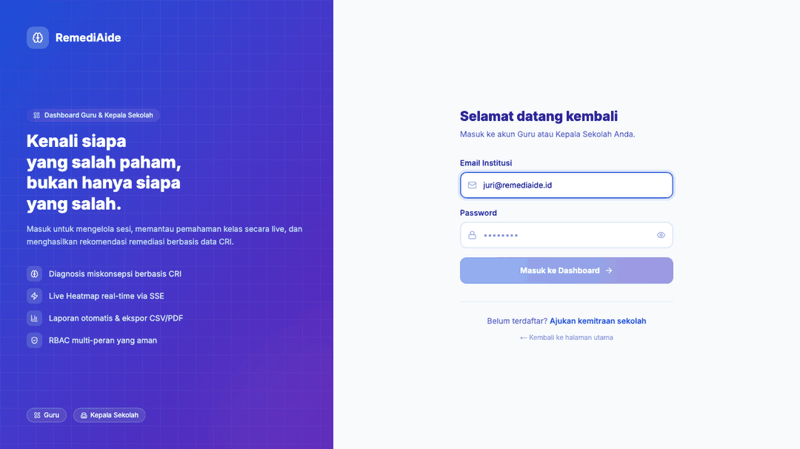
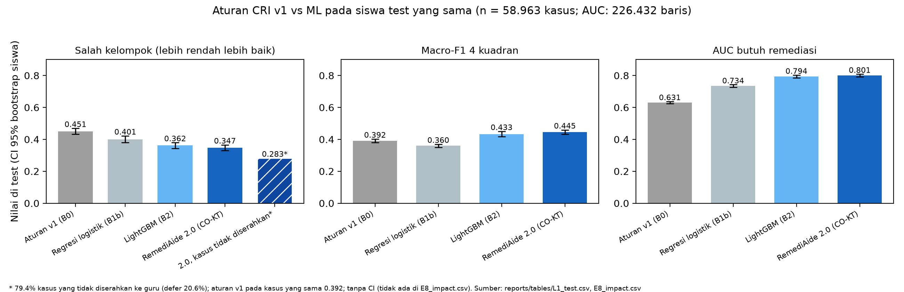
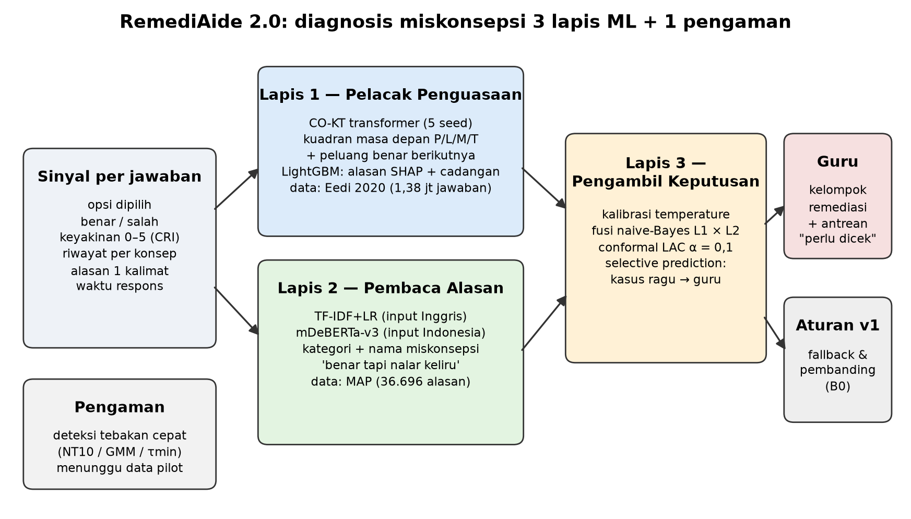

# RemediAide 2.0

**Guru tahu siswa mana yang salah. Yang sulit adalah tahu kenapa, dan itu yang dicoba dijawab RemediAide 2.0.**

[](https://github.com/muhammadkiro516-netizen/remediaide/actions/workflows/ci.yml) [](https://colab.research.google.com/github/muhammadkiro516-netizen/remediaide/blob/main/ml/notebooks/00_demo_cepat.ipynb)

Submisi CAC Machine Learning Solution Challenge 2026 · SDG 4.1 (hasil belajar) dan SDG 10.2 (akses yang setara)
Tim: Muhammad Salman Al Farisi (ketua), Lubna Maryam, Muhammad Farel Rizky · Universitas Pancasila

| Coba sendiri | |
| --- | --- |
| Web (akun juri, hanya-baca) | https://remediaide.vercel.app · email `juri@remediaide.id` · password ada di formulir submisi |
| Kelas demo sebagai siswa | buka https://remediaide.vercel.app/student/join, PIN `826730` |
| Notebook 5 menit di Colab | [buka di Colab](https://colab.research.google.com/github/muhammadkiro516-netizen/remediaide/blob/main/ml/notebooks/00_demo_cepat.ipynb), tanpa GPU dan tanpa login |
| Video demo 2 menit | [ISI: URL video] |
| Dataset terjemahan Indonesia | [Hugging Face: remediaide-map-id](https://huggingface.co/datasets/avlfarizii/remediaide-map-id) (publik, MIT; cermin [Kaggle](https://www.kaggle.com/datasets/avlsalmoon/remediaide-map-id)) |





## Masalahnya

Di PISA 2025 hanya 17% siswa Indonesia yang mencapai Level 2 matematika, sedangkan rata-rata OECD 65%
([OECD, 2026](https://www.oecd.org/en/publications/pisa-2025-results-volume-i-country-notes_2d4ff9ea-en/indonesia_9c880f8a-en.html)).
Nilai ujian memberi tahu siapa yang salah, tetapi tidak membedakan siswa yang belum tahu dari siswa yang yakin dengan
konsep keliru. Keduanya butuh remediasi yang berbeda.

Banyak sekolah memakai Certainty of Response Index (CRI): siswa menjawab, lalu menilai seberapa yakin dia. Jawaban
benar dan yakin dianggap paham; salah tapi yakin dianggap miskonsepsi. Aturan 2×2 ini kami pakai di RemediAide v1. Saat
kami mengujinya pada data nyata, hasilnya buruk.

## Yang kami temukan

Kami menguji aturan v1 pada 773 siswa Eedi yang kami kunci sejak hari pertama dan tidak pernah dipakai untuk melatih
atau memilih model (58.963 kasus). "Salah kelompok" berarti siswa dimasukkan ke kelompok remediasi yang tidak sesuai
dengan kondisinya tiga soal berikutnya.

| Pendekatan | Salah kelompok (lebih kecil lebih baik) |
| --- | --- |
| Aturan CRI v1 | 45,1% [43,1–46,9] |
| Regresi logistik, hanya melihat kesulitan soal | 42,9% [40,3–45,8] |
| Regresi logistik, kesulitan soal + riwayat konsep | 40,1% [38,0–42,2] |
| **RemediAide 2.0** | **34,7% [33,0–36,6]** |
| RemediAide 2.0, setelah 20,6% kasus paling ragu diserahkan ke guru | **28,3%** pada kasus yang tersisa (aturan v1 di kasus yang sama: 39,2%) |

Terhadap pembanding sederhana yang paling kuat (40,1%), model kami masih lebih baik 5,3 poin [4,8–5,9]. Aturan v1
bahkan kalah dari model yang cuma melihat kesulitan soal, walaupun model itu hampir selalu menebak "Paham". Lebih dari seperempat siswa yang dia
nyatakan "Paham" (27,8%) justru belum tuntas di soal berikutnya, jadi mereka tidak pernah mendapat remediasi.

Sumber: [`ml/reports/tables/headline.json`](ml/reports/tables/headline.json), [`L1_test.csv`](ml/reports/tables/L1_test.csv),
[`E1_b0_test.csv`](ml/reports/tables/E1_b0_test.csv). Angka dalam kurung adalah selang kepercayaan 95% dari bootstrap per siswa.

## Cara kerjanya



Siswa menjawab soal pilihan ganda di HP, menggeser tingkat keyakinan 0–5, dan pada beberapa soal menulis alasan satu
kalimat. Dari situ ada tiga lapis model:

- **Lapis 1 membaca riwayat.** Transformer kecil (CO-KT) memprediksi kondisi siswa di soal berikutnya pada konsep yang
  sama. Ia membaca urutan jawaban, keyakinan, opsi yang dipilih, dan jeda waktu, tidak hanya satu jawaban terakhir.
- **Lapis 2 membaca alasan siswa** dan menamai miskonsepsinya, misalnya "angka yang lebih panjang dianggap lebih besar".
  Lapis ini juga menangkap siswa yang menjawab benar dengan nalar keliru, kasus yang mustahil ditangkap aturan v1.
- **Lapis 3 memutuskan kapan model harus diam.** Kasus yang terlalu meragukan tidak ditebak; kasus itu masuk panel
  "Perlu dicek guru".

Kalau layanan ML mati, aplikasi tetap jalan dengan aturan v1. Di https://remediaide.vercel.app layanan ML Python sengaja tidak dihosting (D-28): kelas demo
juri memakai hasil model asli yang dihitung sekali lalu disimpan, sedangkan sesi baru memakai aturan v1 dan Lapis 1 di browser.

## Hasil per lapis

**Lapis 1**, pada siswa test. AUC untuk "butuh remediasi atau tidak" naik dari 0,631 (aturan v1) menjadi 0,801. Kalau
keyakinan siswa dihapus dari input, macro-F1 turun 0,158, sedangkan menghapus opsi jawaban hampir tidak berpengaruh.
Keyakinan siswa tetap berguna; yang salah selama ini adalah cara memakainya sebagai ambang tetap.

**Lapis 2**, pada 36.696 alasan siswa (dataset MAP, 15 soal). Aturan v1 menangkap 0% siswa "benar tapi nalarnya
keliru", karena desainnya menganggap benar + yakin = paham. Model kami menangkap 37,5%, dan antrean guru menangkap
separuh kasus seperti itu sambil hanya menandai 1,4–1,7% jawaban benar.

**Bahasa Indonesia.** Kami menerjemahkan alasan siswa ke Bahasa Indonesia dengan mesin, lalu menguji ulang. TF-IDF
jatuh dari 0,916 ke 0,766 (MAP@3), sedangkan mDeBERTa multibahasa hanya turun dari 0,911 ke 0,895. Versi kecilnya
(118 MB, 7,8 ms per alasan di CPU laptop) masih mendapat 0,834.

Rincian semua angka: [`ml/reports/RESULTS.md`](ml/reports/RESULTS.md).

## Yang belum berhasil

Bagian ini kami tulis karena juri berhak tahu sebelum menemukannya sendiri.

- **Di data test, model lebih jarang menangkap miskonsepsi dibanding aturan v1.**

  | Kondisi siswa di soal berikutnya | Aturan v1 | RemediAide 2.0 |
  | --- | --- | --- |
  | Paham | 71,3% | 88,6% |
  | Tebakan beruntung | 14,1% | 5,0% |
  | Miskonsepsi | 40,0% | 36,8% |
  | Tidak paham | 27,4% | 45,2% |

  Penurunan salah kelompok paling banyak datang dari kelas Paham dan Tidak paham. Anehnya, di validasi silang
  hasilnya terbalik (Miskonsepsi 44,5% vs 42,3%), jadi kami belum tahu apakah celah ini nyata atau kebetulan di
  773 siswa test. Setelah test disegel, kami cek dua penambal di validasi silang saja. Antrean guru menangkap
  24,8% kasus Miskonsepsi yang terlewat model, sehingga 58,1% kasus seperti itu tertangkap atau sampai ke guru
  (aturan v1: 42,0%). Kalau bobot kelas Miskonsepsi dinaikkan ke 1,5, recall-nya naik ke 61,2% sementara salah
  kelompok hanya naik dari 35,1% ke 36,2%. Bobot itu belum kami pakai di produk karena belum pernah diuji di test;
  keputusannya menunggu data pilot ([D-26](docs/cac/DECISIONS.md)).
- **Model lebih sering salah untuk siswa yang lemah.** Salah kelompok 50,9% pada kuartil kemampuan terbawah,
  dibanding 19,5% pada kuartil teratas. Aturan v1 juga timpang di kelompok yang sama; model kami lebih akurat di
  setiap kelompok, tapi kesenjangannya belum hilang.
- **Labelnya bukan label guru.** "Kondisi tiga soal berikutnya" adalah pendekatan. Pilot dengan dua guru di
  SMA Advent Tanjung Barat sudah disiapkan ([panduan sesi](docs/cac/pilot/PANDUAN_SESI.md)), tetapi belum dijalankan.
- **Alasan berbahasa Indonesia masih hasil terjemahan mesin.** Dari 100 sampel yang kami periksa, 20 punya kesalahan besar.
- **Menyerahkan 20% kasus ke guru menurunkan salah kelompok 18,5%**, di bawah target 25% yang kami tetapkan sebelum
  melihat hasil.

## Kenapa angkanya bisa dipercaya

Semua keputusan penting (cara membagi data, metrik, ambang) kami kunci di [`DECISIONS.md`](docs/cac/DECISIONS.md)
sebelum hasil keluar, dan git mencatat tanggal tiap keputusan itu. Data test dibuka satu kali pada 19 November 2026; segelnya ada
di [`TEST_OPENED.json`](ml/reports/TEST_OPENED.json). Aturan v1 dipakai apa adanya sebagai pembanding: versi Python-nya
lolos 27 tes kesetaraan terhadap kode TypeScript aslinya. [CI di GitHub Actions](.github/workflows/ci.yml) menjalankan seluruh tes
ML dan web, mengeksekusi notebook demo, mengecek tidak ada token di riwayat git, dan memeriksa bahwa setiap angka di README
ada di file sumbernya.

## Menjalankan sendiri

Cepat: buka [`00_demo_cepat.ipynb` di Colab](https://colab.research.google.com/github/muhammadkiro516-netizen/remediaide/blob/main/ml/notebooks/00_demo_cepat.ipynb) lalu *Run all*. Di CPU biasa selesai kurang dari satu menit setelah paket terpasang.

Penuh (sekitar 4 jam di laptop, bagian GPU memakai output kernel Kaggle yang tersimpan):
```bash
cd ml
make setup        # Python 3.12, dependensi terkunci
make data-raw     # unduh Eedi dan MAP, cek sha256
make test
make all          # data, Lapis 1–3, evaluasi
make check-repro  # bandingkan dengan tabel di repo (toleransi ±0,005)
```

Aplikasi web (Node.js 20, PostgreSQL 15): lihat [`docs/DEVELOPER.md`](docs/DEVELOPER.md), [`ml/README.md`](ml/README.md), dan [`.env.example`](.env.example).

## Data

| Dataset | Isi | Lisensi | Di repo |
| --- | --- | --- | --- |
| [Eedi NeurIPS 2020](https://arxiv.org/abs/2007.12061), Task 3 & 4 | 1.382.727 jawaban, 4.918 siswa, 948 soal, keyakinan siswa | CC BY-NC-ND 4.0 | Tidak. Lisensinya melarang membagikan versi olahan, jadi kami sertakan skrip unduh dan sha256 |
| MAP, Charting Student Math Misunderstandings | 36.696 alasan siswa, 15 soal, 35 label miskonsepsi | MIT | Terjemahan Indonesia: [Hugging Face](https://huggingface.co/datasets/avlfarizii/remediaide-map-id) · [Kaggle](https://www.kaggle.com/datasets/avlsalmoon/remediaide-map-id). Hasil QA 100 sampel: [`translation_qa.csv`](ml/reports/tables/translation_qa.csv) |
| Kamus miskonsepsi Indonesia | 39 pasangan (soal, miskonsepsi) dari Tabel 1 Rittle-Johnson dkk., dengan deskripsi Bahasa Indonesia | MIT | [`map_misconception_dictionary.csv`](ml/reports/tables/map_misconception_dictionary.csv) |

Kartu data: [`ml/DATA_CARD.md`](ml/DATA_CARD.md). Kartu model: [`ml/MODEL_CARD.md`](ml/MODEL_CARD.md).
Laporan teknis lengkap, dengan bab yang mengikuti lima kriteria penilaian: [`ml/REPORT.md`](ml/REPORT.md).

## Privasi siswa

Layanan ML tidak menyimpan data siswa dan tidak mencatat isi alasan. ID siswa di-hash. Data pilot hanya boleh
diekspor setelah orang tua menandatangani persetujuan, sesuai Pasal 25 UU Pelindungan Data Pribadi, dan tidak pernah
masuk repo.

## Riwayat

RemediAide v1 adalah versi awal yang kami buat sebelumnya: aplikasi web dengan aturan CRI, tanpa ML. Semua komponen ML, data olahan,
eksperimen, dan hasil di repo ini dibuat baru untuk CAC MLSC 2026, mulai 18 November 2026.

Kode ML: MIT ([`ml/LICENSE`](ml/LICENSE)). Lisensi kode web: MIT ([`LICENSE`](LICENSE)). Cara mengutip: [`CITATION.cff`](CITATION.cff).
