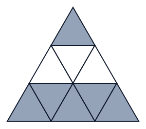
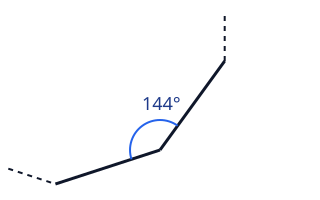
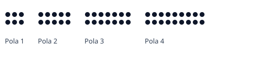

# Instrumen pilot RemediAide-ID (15 soal MAP)

Versi 1.0. Sumber: MAP (MIT), terjemahan manual. Aturan soal kunci: D-25: 5 soal dengan entropi label miskonsepsi tertinggi di MAP.
Dibuat otomatis oleh `ml/scripts/pilot_materials.py`; teks Indonesia adalah revisi manual dari terjemahan mesin.
Soal bertanda **[cek guru]** perlu diperiksa guru sebelum dipakai.

## 1. MAP 31772 **[cek guru]**

Berapa bagian dari bangun segitiga di bawah ini yang TIDAK diarsir? Tuliskan dalam bentuk pecahan paling sederhana.

- **A.** 1/3  ✔
- **B.** 3/6
- **C.** 3/8
- **D.** 3/9

Asli: What fraction of the shape is not shaded? Give your answer in its simplest form. [Image: A triangle split into 9 equal smaller triangles. 6 of them are shaded.] · Terjemahan mesin: Bagian mana dari bentuk ini yang tidak dibayangi? Berikan jawabanmu dengan cara yang paling sederhana. Segitiga terbagi menjadi 9 segitiga yang lebih kecil. 6 of them are shaded.]

> Catatan untuk guru: Gambar digambar ulang: segitiga dibagi 9 segitiga kecil sama besar, 6 diarsir. Letak arsiran asli tidak diketahui; cek apakah gambar jelas.

## 2. MAP 31774 · *minta alasan*

Hitunglah 1/2 ÷ 6.

- **A.** 1/12  ✔
- **B.** 1/3
- **C.** 3
- **D.** 6/2

Asli: Calculate \( \frac{1}{2} \div 6 \) · Terjemahan mesin: Hitung \( \frac{1}{2} \div 6 \)

## 3. MAP 31777 **[cek guru]** · *minta alasan*

Sebuah kotak berisi 120 keping. Setiap keping berwarna merah atau biru. Sebanyak 3/5 dari keping itu berwarna merah. Berapa banyak keping merah?

- **A.** 24
- **B.** 48
- **C.** 60
- **D.** 72  ✔

Asli: A box contains \( 120 \) counters. The counters are red or blue. \( \frac{3}{5} \) of the counters are red. How many red counters are there? · Terjemahan mesin: Sebuah kotak berisi counter \( 120 \). counter merah atau biru. \( \frac{3}{5} \) dari counter merah. Berapa banyak counter merah yang ada?

> Catatan untuk guru: 'counters' diterjemahkan 'keping'.

## 4. MAP 31778

A/10 = 9/15. Berapa nilai A?

- **A.** 3
- **B.** 4
- **C.** 6  ✔
- **D.** 9

Asli: \( \frac{A}{10}=\frac{9}{15} \) What is the value of \( A \) ? · Terjemahan mesin: \( \frac{A}{10}=\frac{9}{15} \) Berapa nilai \( A \)?

## 5. MAP 32829 · *minta alasan*

2y = 24. Berapa nilai y?

- **A.** 4
- **B.** 12  ✔
- **C.** 22
- **D.** 48

Asli: \( 2 y=24 \) What is the value of \( y \) ? · Terjemahan mesin: \( 2 y=24 \) Berapa nilai \( y \)?

## 6. MAP 32833 **[cek guru]**

Hitunglah 2/3 × 5.

- **A.** 2/15
- **B.** 3 1/3  ✔
- **C.** 5 2/3
- **D.** 10/15

Asli: Calculate \( \frac{2}{3} \times 5 \) · Terjemahan mesin: Hitung \( \frac{2}{3} \times 5 \)

> Catatan untuk guru: Pecahan campuran ditulis '3 1/3'; cek apakah siswa terbiasa dengan penulisan ini.

## 7. MAP 32835 **[cek guru]**

Bilangan manakah yang paling besar?

- **A.** 6
- **B.** 6,0001
- **C.** 6,079
- **D.** 6,2  ✔

Asli: Which number is the greatest? · Terjemahan mesin: Nomor mana yang terbesar?

> Catatan untuk guru: Tanda desimal diubah ke koma (Indonesia). Miskonsepsi 'lebih banyak angka = lebih besar' tetap teruji.

## 8. MAP 33471

Sebuah kantong berisi 24 bola berwarna kuning dan hijau. Sebanyak 3/8 dari bola itu berwarna kuning. Berapa banyak bola hijau?

- **A.** 3
- **B.** 8
- **C.** 9
- **D.** 15  ✔

Asli: A bag contains \( 24 \) yellow and green balls. \( \frac{3}{8} \) of the balls are yellow. How many of the balls are green? · Terjemahan mesin: Tas berisi \( 24 \) kuning dan bola hijau. \( \frac{3}{8} \) bola kuning. Berapa banyak bola hijau?

## 9. MAP 33472 · *minta alasan*

1/3 + 2/5 = ...

- **A.** 3/15
- **B.** 3/8
- **C.** 11/15  ✔
- **D.** 11/30

Asli: \( \frac{1}{3}+\frac{2}{5}= \) · Terjemahan mesin: \( \frac{1}{3}+\frac{2}{5}= \)

## 10. MAP 33474 **[cek guru]**

Sari punya 2/3 bagian dari sebuah kue utuh di kulkas. Rudi memakan 1/3 dari potongan kue itu. Berapa bagian dari kue utuh yang dimakan Rudi? Pilih kalimat matematika yang tepat untuk menyelesaikan soal ini.

- **A.** 1/3 × 2/3  ✔
- **B.** 1/3 + 2/3
- **C.** 2/3 ÷ 1/3
- **D.** 2/3 − 1/3

Asli: Sally has \( \frac{2}{3} \) of a whole cake in the fridge. Robert eats \( \frac{1}{3} \) of this piece. What fraction of the whole cake has Robert eaten? Choose the number sentence that would solve the word problem. · Terjemahan mesin: Sally memiliki \( \frac{2}{3} \) seluruh kue di lemari es. Robert makan \( \frac{1}{3} \) bagian ini. Bagian mana dari kue yang dimakan Robert? Pilih nomor kalimat yang akan memecahkan masalah kata.

> Catatan untuk guru: Nama Sally/Robert diganti Sari/Rudi.

## 11. MAP 76870 **[cek guru]** · *minta alasan*

Gambar di bawah ini adalah bagian dari sebuah segi banyak beraturan. Berapa banyak sisi segi banyak itu?

- **A.** 5
- **B.** 6
- **C.** 10  ✔
- **D.** Informasi tidak cukup

Asli: This is part of a regular polygon. How many sides does it have? [Image: A diagram showing an obtuse angle labelled 144 degrees] · Terjemahan mesin: Ini adalah bagian dari poligon biasa. Berapa banyak sisi yang ia miliki? [Image: Diagram menampilkan sudut obtuse berlabel 144 derajat]

> Catatan untuk guru: Gambar digambar ulang: dua sisi bertemu pada sudut dalam 144°. Cek apakah sudut terbaca sebagai sudut dalam.

## 12. MAP 89443

Bilangan berapa yang tepat untuk mengisi kotak?  (−8) − (−5) = □

- **A.** −13
- **B.** −3  ✔
- **C.** 3
- **D.** 13

Asli: What number belongs in the box? \( (-8)-(-5)= \square\) · Terjemahan mesin: Nomor berapa yang termasuk dalam kotak? \( (-8)-(-5)= \square\)

## 13. MAP 91695 **[cek guru]**

Titik-titik disusun membentuk pola seperti gambar. Pola 1 terdiri atas 6 titik, Pola 2 terdiri atas 10 titik, Pola 3 terdiri atas 14 titik, dan Pola 4 terdiri atas 18 titik. Berapa banyak titik pada Pola 6?

- **A.** 20
- **B.** 22
- **C.** 26  ✔
- **D.** 36

Asli: Dots have been arranged in these patterns: [Image: Pattern 1 consists of 6 dots, Pattern 2 consists of 10 dots, Pattern 3 consists of 14 dots and Pattern 4 consists of 18 dots] How many dots would there be in Pattern \( 6 \) ? · Terjemahan mesin: Titik-titik telah disusun dalam pola ini: [Image: Pola 1 terdiri dari 6 titik, Pola 2 terdiri dari 10 titik, Pola 3 terdiri dari 14 titik dan Pola 4 terdiri dari 18 titik] Berapa banyak titik akan ada dalam Pola \( 6 \) ?

> Catatan untuk guru: Gambar digambar ulang (dua baris titik). Susunan titik asli tidak diketahui; jumlah titik sesuai soal.

## 14. MAP 104665

Tiga orang membutuhkan total 192 jam untuk membangun sebuah tembok. Berapa lama waktu yang dibutuhkan jika 12 orang membangun tembok yang sama?

- **A.** 48 jam  ✔
- **B.** 64 jam
- **C.** 192 jam
- **D.** 768 jam

Asli: It takes \( 3 \) people a total of \( 192 \) hours to build a wall. How long would it take if \( 12 \) people built the same wall? · Terjemahan mesin: Dibutuhkan \( 3 \) orang total \( 192 \) jam untuk membangun dinding. Berapa lama waktu yang dibutuhkan jika \( 12 \) orang membangun dinding yang sama?

## 15. MAP 109465 **[cek guru]**

Peluang terjadinya suatu kejadian adalah 0,9. Pernyataan manakah yang paling tepat menggambarkan kemungkinan kejadian itu?

- **A.** Kemungkinan besar terjadi  ✔
- **B.** Kemungkinan kecil terjadi
- **C.** Mustahil terjadi
- **D.** Pasti terjadi

Asli: The probability of an event occurring is \( 0.9 \). Which of the following most accurately describes the likelihood of the event occurring? · Terjemahan mesin: Kemungkinan dari sebuah peristiwa yang terjadi adalah \( 0.9 \). Mana yang paling akurat menggambarkan kemungkinan terjadinya peristiwa ini?

> Catatan untuk guru: Tanda desimal diubah ke koma.

