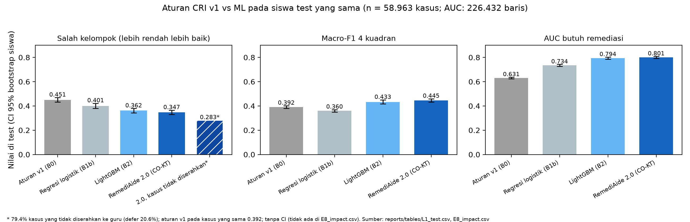
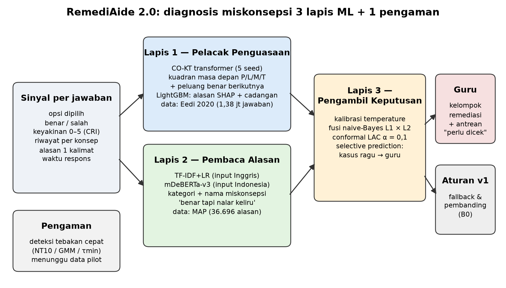

# RemediAide 2.0 — diagnosis miskonsepsi matematika yang menandai kasus ragu untuk guru

> **Angka utama (test, 20% siswa Eedi yang dikunci sejak awal; 58.963 kasus, 773 siswa).** Aturan CRI v1 salah
> mengelompokkan **45,1%** kasus [CI 95% 43,1–46,9]. RemediAide 2.0 salah mengelompokkan **34,7%** [33,0–36,6]:
> turun **10,3 poin** [9,7–10,9], atau **22,9% relatif** (aproksimasi 21,6–24,2%). Model lalu menyerahkan **20,6%**
> kasus paling meragukan ke guru. Pada **79,4%** kasus sisanya, salah kelompok **28,3%**, sedangkan aturan v1 pada
> kasus yang sama **39,2%**.
> Sumber: [`reports/tables/headline.json`](reports/tables/headline.json), rincian di [`reports/RESULTS.md`](reports/RESULTS.md).



Submisi CAC Machine Learning Solution Challenge 2026. Laporan teknis: [`REPORT.md`](REPORT.md). Kartu model:
[`MODEL_CARD.md`](MODEL_CARD.md). Kartu data: [`DATA_CARD.md`](DATA_CARD.md). Hasil: [`reports/RESULTS.md`](reports/RESULTS.md).
Bukti kernel GPU Kaggle (log + metrik): [`kaggle/evidence/`](kaggle/evidence/).

---

## 1. Masalah dan SDG
- **PISA 2025:** hanya 17% siswa Indonesia mencapai minimal Level 2 matematika (OECD 65%), sama dengan 2022
  ([OECD](https://www.oecd.org/en/publications/pisa-2025-results-volume-i-country-notes_2d4ff9ea-en/indonesia_9c880f8a-en.html)).
  **Rapor Pendidikan 2025** numerasi: SD 59,45%, SMP 70,81%, SMA 67,14%, SMK 60,22% mencapai kompetensi minimum
  ([gebrak.id](https://www.gebrak.id/?p=18182)).
- Guru butuh tahu *siapa* yang perlu remediasi dan *miskonsepsi apa*. Alat yang umum dipakai, **CRI 2×2**
  (benar/salah × yakin/tidak; [Hasan dkk. 1999](https://iopscience.iop.org/article/10.1088/0031-9120/34/5/304)),
  adalah aturan tetap dengan tiga titik buta:
  1. **Jebakan jawaban benar** — siswa yang benar dengan nalar keliru otomatis "Paham".
  2. **Miskonsepsi tanpa nama** — aturan tidak menyebut miskonsepsi yang mana.
  3. **Tidak tahu kapan dirinya salah** — tidak ada ketidakpastian, sehingga tidak bisa menyerahkan kasus sulit ke guru.
- Kami mengukur titik buta itu: di test Eedi, 27,8% siswa yang dinyatakan "Paham" oleh aturan v1 ternyata belum tuntas
  pada tiga soal berikutnya di konsep yang sama ([`E1_b0_test.csv`](reports/tables/E1_b0_test.csv)).
- **SDG 4.1** (hasil belajar matematika, utama), **SDG 10.2** (analisis fairness), **SDG 4.c** (waktu guru).

## 2. Solusi: 3 lapis ML + 1 pengaman



| Lapis | Tugas | Model produksi | Data |
| --- | --- | --- | --- |
| L1 Pelacak Penguasaan | kuadran masa depan siswa per konsep (Paham / Tebakan beruntung / Miskonsepsi / Tidak paham) + peluang benar berikutnya | **CO-KT** (transformer knowledge tracing dengan keyakinan dan opsi jawaban), ensemble 5 seed; LightGBM sebagai penjelas SHAP + cadangan | Eedi NeurIPS 2020 Task 3&4 |
| L2 Pembaca Alasan | kategori + nama miskonsepsi dari alasan satu kalimat, termasuk "benar tapi nalar keliru" | TF-IDF+LR untuk input Inggris, **mDeBERTa-v3** untuk input Indonesia | MAP (Kaggle, MIT) + terjemahan Indonesia |
| L3 Pengambil Keputusan | kalibrasi, fusi L1×L2, himpunan prediksi conformal, serahkan kasus ragu ke guru | temperature scaling, naive-Bayes, LAC/APS α = 0,1, defer 20% | — |
| Pengaman | deteksi tebakan cepat | NT10 / GMM / τmin (menunggu data pilot) | — |

**Yang baru dibanding v1:** (1) CRI yang *dipelajari* dari data, bukan ambang tetap; (2) diagnosis bernama, termasuk pada
jawaban benar; (3) kasus ragu ditandai dan diserahkan ke guru (conformal + selective prediction); (4) siap untuk alasan berbahasa
Indonesia. Aturan v1 tetap dikembalikan di setiap respons sebagai pembanding dan fallback.

## 3. Data
| Dataset | Isi | Lisensi | Peran |
| --- | --- | --- | --- |
| [Eedi NeurIPS 2020 Task 3&4](https://eedi.com/projects/neurips-education-challenge) | 1.382.727 jawaban, 4.918 siswa, 948 soal, 57 konsep, keyakinan 0–100 | CC BY-NC-ND 4.0 | L1, E1, E2, E5, E6, E8 |
| [MAP — Charting Student Math Misunderstandings](https://www.kaggle.com/competitions/map-charting-student-math-misunderstandings) | 36.696 alasan, 15 soal, 65 target (kategori:miskonsepsi) | MIT | L2, E3, E4 |
| Terjemahan MAP → Indonesia (karya kami) | opus-mt-en-id + pelindung ekspresi matematika, QA manual 100 sampel | turunan MIT | E4 |

- **Anti-leakage:** fitur hanya dari masa lalu siswa; encoding target out-of-fold; split per siswa (Eedi: 20% siswa
  test terkunci + GroupKFold 5) dan per soal (MAP); setiap pipeline fitur punya unit test leakage.
- **Label E1:** kuadran *masa depan* = 3 percobaan berikutnya di konsep yang sama (tuntas jika ≥ 2/3 benar, yakin jika
  rata-rata keyakinan ≥ 3) — bisa diuji tanpa label guru.
- Detail: [`DATA_CARD.md`](DATA_CARD.md), [`data/README.md`](data/README.md), notebook `01_eda` dan `02_preprocessing_features`.

## 4. Hasil utama
Semua angka dengan CI 95% bootstrap per siswa dan selalu di samping baselinenya; test dibuka sekali (segel [`reports/TEST_OPENED.json`](reports/TEST_OPENED.json)).

| Pertanyaan | Hasil | Sumber |
| --- | --- | --- |
| E1: seberapa sering aturan v1 salah? (test) | salah kelompok 0,451 [0,431–0,469]; 27,8% "Paham" belum tuntas berikutnya | `E1_b0_test.csv` |
| L1: RemediAide 2.0 vs aturan v1 (test) | salah kelompok 0,347 vs 0,451; macro-F1 0,445 vs 0,392; AUC butuh remediasi 0,801 vs 0,631 | `L1_test.csv` |
| L1: CO-KT vs LightGBM (test) | salah kelompok −0,014 [−0,018; −0,011]; AUC next-correct 0,796 vs 0,795 | `L1_test_pairwise.csv` |
| E2: sinyal apa yang penting? (CV) | macro-F1 CO-KT penuh 0,480; tanpa keyakinan turun 0,158 [0,146–0,171]; tanpa opsi hanya 0,002 | `E2_cokt_ablation_cv.csv` |
| E3: jebakan jawaban benar (CV MAP) | aturan v1 recall 0; TF-IDF recall 0,375 [0,329–0,422], presisi 0,821; mDeBERTa 0,323 | `E3_true_misconception.csv` |
| E4: alasan berbahasa Indonesia (CV MAP) | MAP@3 mDeBERTa 0,911 → 0,895 (−0,016); TF-IDF 0,916 → 0,766 (−0,150) | `E4_crosslingual.csv` |
| E5: ketidakpastian (test) | cakupan conformal 0,900 untuk target 90% (aturan v1: tidak ada himpunan); ukuran himpunan 1,90; defer menurunkan salah kelompok 18,5%, **di bawah target 25%** (fallback 20%, D-21) | `E5_test.json` |
| E6: adil? (test) | **tidak ada klaim adil**: selisih salah kelompok pupil premium +0,121 (aturan v1 +0,095), kemampuan rendah +0,314 (aturan v1 +0,307) | `E6_fairness.csv` |
| E8: dampak bagi guru (test) | defer 20,6% (±99 kasus per kelas 32×15); sisa salah kelompok 0,283 vs aturan v1 0,392 pada kasus yang sama | `E8_impact.csv` |

## 5. Cara menjalankan dari nol
```bash
cd ml
make setup            # venv Python 3.12 + dependensi (lihat requirements-lock.txt)
make data-raw         # unduh Eedi (blob publik) + MAP (butuh Kaggle CLI + menerima aturan kompetisi)
make test             # tes: kesetaraan B0 vs engine.ts, leakage, kontrak layanan, dll.
make kaggle-outputs   # output GPU tersimpan (CO-KT, mDeBERTa); atau jalankan ulang kernel di kaggle/kernels/
make all              # data → L1 → L2 → L3 → evaluasi test; ±4 jam di laptop CPU (lihat REPORT §3)
make check-repro      # bandingkan tabel hasil dengan versi di repo (toleransi ±0,005)
```
- Bagian GPU (CO-KT 37,1 menit untuk CV penuh + 5,5 menit model produksi; mDeBERTa 166,5 + 166,3 menit;
  [`compute_summary.csv`](reports/tables/compute_summary.csv)) dijalankan di GPU Kaggle dengan `kaggle/kernels/*/train.py`; kodenya sama dengan `scripts/train_cokt*.py` dan `src/remediaide_ml/l2/encoder.py`.
- Layanan: `uvicorn service.app:app` → `GET /health`, `POST /v1/diagnose` (kontrak di `REPORT.md` §5).
- Hugging Face Spaces (Docker): `service/hf_space/` (README Space + Dockerfile); langkah deploy di `docs/cac/MANUAL_ACTIONS.md` M17.

## 6. Struktur repo
```
src/remediaide_ml/   data/ features/ l1/ l2/ l3/ guard/ eval/ diagnose.py bundle.py cri_rule.py (B0 = aturan v1)
scripts/             satu skrip per langkah pipeline (lihat Makefile)
notebooks/           01–07, tipis, memanggil modul, output tersimpan
kaggle/kernels/      kernel GPU (CO-KT CV, CO-KT produksi, mDeBERTa, distilasi); kaggle/evidence/ = log + metrik
service/             FastAPI + Dockerfile
reports/             RESULTS.md, tables/, figures/
models/              artefak produksi (biner besar diunduh, lihat models/README.md)
tests/               pytest
data/                README + skrip unduh + manifest sha256 (data mentah tidak di-commit)
```

## 7. Keterbatasan dan etika
- Label kuadran masa depan adalah proxy, bukan label guru; validasi guru (kappa) direncanakan di pilot.
- Alasan berbahasa Indonesia dievaluasi dengan **terjemahan mesin**, bukan tulisan asli siswa Indonesia.
- Model lebih sering salah untuk kelompok rentan (E6); kasus ragu, yang lebih banyak di kelompok ini, selalu ke guru.
- Model **tidak boleh** dipakai untuk menentukan nilai rapor atau kenaikan kelas — hanya untuk mengelompokkan remediasi.
- Data pilot siswa (bila ada) anonim, butuh persetujuan orang tua (UU PDP Pasal 25), tidak pernah keluar dari laptop tim.
- Daftar lengkap: `REPORT.md` §6.

## 8. Riwayat, kontributor, lisensi
- **Riwayat:** RemediAide v1 (aplikasi web Next.js dengan aturan CRI 2×2 tanpa ML) pernah diikutkan pada LIDM 2026.
  Seluruh komponen ML, dataset olahan, eksperimen, dan hasil di repo ini baru dibuat untuk CAC MLSC 2026. Aturan v1
  dipakai apa adanya sebagai baseline B0 (`src/remediaide_ml/cri_rule.py`, setara dengan `engine.ts` — 27 tes kesetaraan).
- **Kontributor:** Salman (pemilik proyek).
- **Lisensi kode:** MIT (`LICENSE`). Data mengikuti lisensi masing-masing (lihat `DATA_CARD.md`).
- **Sitasi dataset:** Wang dkk. (2020), *Diagnostic Questions: The NeurIPS 2020 Education Challenge*, arXiv:2007.12061;
  Rittle-Johnson dkk. (2025), MAP/MIME, AIME-Con WIP ([aclanthology 2025.aimecon-wip.3](https://aclanthology.org/2025.aimecon-wip.3.pdf)).
