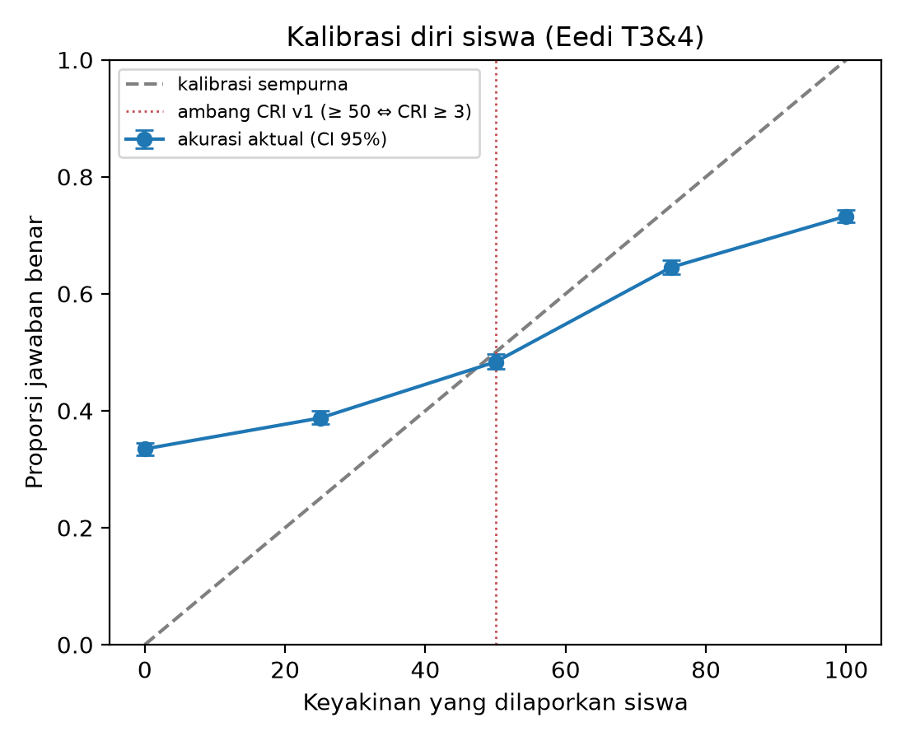
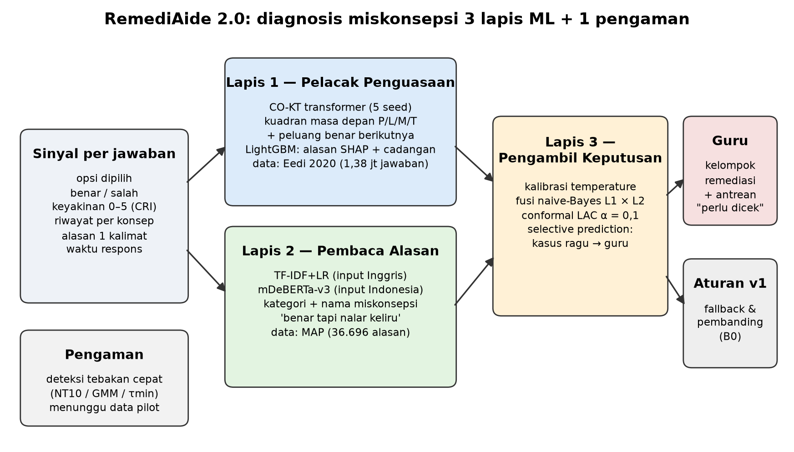
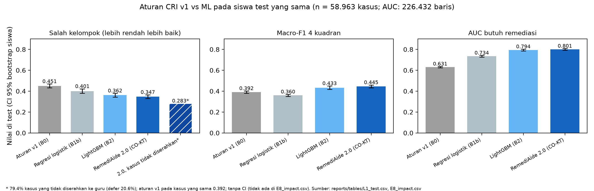
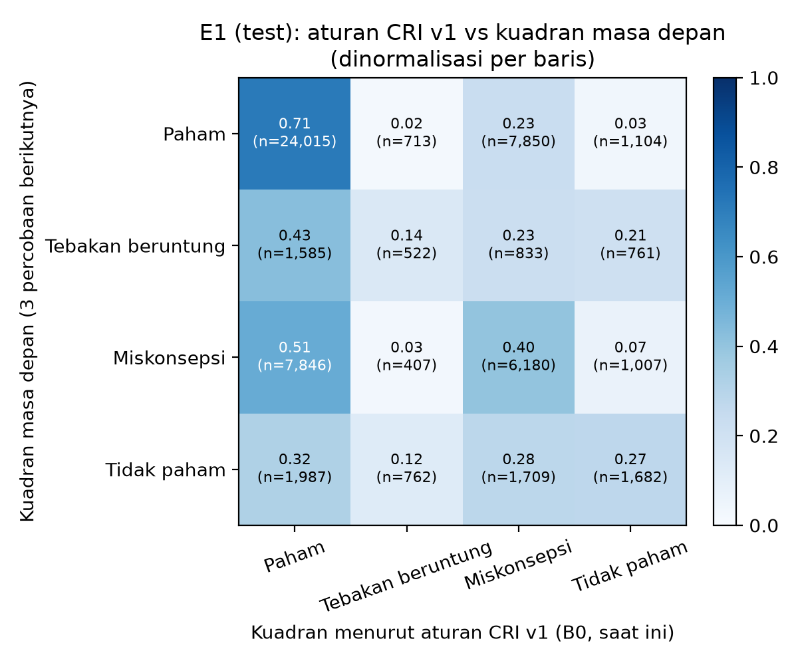
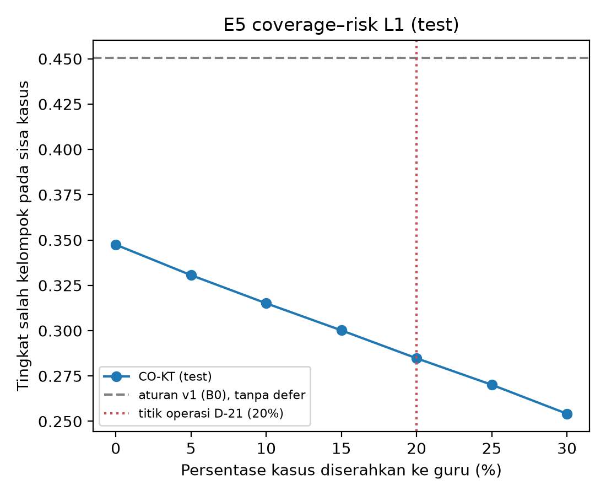

# Laporan Teknis — RemediAide 2.0

CAC Machine Learning Solution Challenge 2026 · Babak penyisihan · Bahasa Indonesia

> **Angka utama (test, 20% siswa Eedi yang dikunci sejak awal; 58.963 kasus, 773 siswa).** Aturan CRI v1 salah
> mengelompokkan **45,1%** kasus [CI 95% 43,1–46,9]. RemediAide 2.0 salah mengelompokkan **34,7%** [33,0–36,6]:
> turun **10,3 poin** [9,7–10,9], atau **22,9% relatif** (aproksimasi 21,6–24,2%). Model lalu menyerahkan **20,6%**
> kasus paling meragukan ke guru. Pada **79,4%** kasus sisanya, salah kelompok **28,3%**, sedangkan aturan v1 pada
> kasus yang sama **39,2%**.
> Sumber: `reports/tables/headline.json` (diturunkan dari `E8_impact.csv` dan `L1_test.csv`).

**Cara membaca angka.** Setiap angka di laporan ini berasal dari file di `reports/` dan disertai path sumbernya.
`scripts/check_numbers.py` memeriksa bahwa tidak ada angka tanpa sumber. **CV** = validasi silang pada 80% siswa
Eedi. **Test** = 20% siswa Eedi yang dikunci sejak awal (D-04) dan dibuka **sekali** pada 19 Nov 2026 (segel
`reports/TEST_OPENED.json`). Semua analisis yang ditambahkan setelah itu memakai CV saja. MAP tidak punya fold test
terkunci (D-06), jadi semua angka Lapis 2 adalah CV. Keputusan metodologis dikunci di `docs/cac/DECISIONS.md`
(D-01 s.d. D-24) sebelum hasil terkait dilihat.

| Bab | Kriteria penilaian | Bobot |
| --- | --- | --- |
| 1 Pendahuluan dan rumusan masalah | Perumusan masalah | 15% |
| 2 Data | Pengolahan dan kualitas data | 20% |
| 3 Metode | Implementasi ML | 25% |
| 4 Hasil dan analisis error | Evaluasi model | 20% |
| 5 Inovasi dan dampak | Inovasi dan dampak | 20% |
| 6 Keterbatasan dan rencana lanjut | Kejujuran ilmiah (semua kriteria) | — |

---

## 1. Pendahuluan dan rumusan masalah  *(Perumusan masalah, 15%)*

### 1.1 Latar belakang
Hasil belajar matematika Indonesia stagnan. Pada PISA 2025, hanya 17% siswa mencapai minimal Level 2 (rata-rata OECD
65%), sama dengan 2022 [1]. Rapor Pendidikan 2025 mencatat capaian kompetensi minimum numerasi SD 59,45%, SMP 70,81%,
SMA 67,14%, dan SMK 60,22% [2]. Remediasi yang tepat sasaran butuh dua informasi: **siapa** yang belum paham, dan
**miskonsepsi apa** yang dimilikinya.

Alat diagnosis yang banyak dipakai guru dan peneliti Indonesia adalah **Certainty of Response Index (CRI)** [3]. CRI
memetakan setiap jawaban ke kuadran 2×2 (benar/salah × yakin/tidak yakin): *Paham*, *Tebakan beruntung*,
*Miskonsepsi*, dan *Tidak paham*. Penerapan model CRI langsung pada skor mentah diketahui bisa menghasilkan kesimpulan
yang tidak akurat [4]. Aturan tetap ini punya tiga titik buta:

1. **Jebakan jawaban benar.** Siswa yang menjawab benar dengan nalar keliru otomatis dinyatakan "Paham".
2. **Miskonsepsi tanpa nama.** Aturan tidak menyebut miskonsepsi mana yang dimiliki siswa.
3. **Tanpa ukuran ketidakpastian.** Aturan tidak bisa membedakan kasus jelas dari kasus ragu, sehingga tidak bisa
   menyerahkan kasus sulit ke guru.

### 1.2 Riwayat: dari RemediAide v1 ke v2
RemediAide v1 adalah aplikasi web (Next.js) yang kami ikutkan pada LIDM 2026. v1 memakai aturan CRI 2×2 di atas apa
adanya, tanpa machine learning. Seluruh komponen ML, data olahan, eksperimen, dan hasil di laporan ini **baru dibuat
untuk CAC MLSC 2026**. Kode aturan v1 tidak diubah: ia menjadi baseline **B0** (`src/remediaide_ml/cri_rule.py`), dan
27 tes kesetaraan membuktikan hasilnya identik dengan `engine.ts` di aplikasi v1. Dengan begitu, setiap angka
"aturan v1" di laporan ini adalah perilaku aplikasi yang benar-benar dipakai, bukan versi yang dilemahkan.

**Proposal LIDM ≠ kode v1.** Proposal LIDM menulis ambang CRI 2,5, penalti asimetris (α hanya untuk jawaban salah), dan
syarat Aᵢ ≥ 0,7. Kode v1 yang dipakai aplikasi berbeda: ambang `cri >= 3`, semua respons di bawah τmin langsung INVALID
(termasuk yang benar), rumus indeks integritas berbeda, dan voting per soal lintas varian. B0 di laporan ini mengikuti
**kode**, bukan proposal. Pada data Eedi kedua ambang setara, karena keyakinan 0–100 dikonversi ke CRI bilangan bulat
sehingga CRI ≥ 3 ⇔ keyakinan ≥ 50 ⇔ keyakinan/20 ≥ 2,5 (D-03).

### 1.3 Rumusan masalah dan pertanyaan riset
Seberapa sering aturan CRI salah mengelompokkan siswa, dan bisakah ML (a) mengurangi kesalahan itu, (b) memberi nama
miskonsepsi, termasuk pada jawaban benar, dan (c) memisahkan kasus yang cukup jelas dari kasus yang perlu dicek guru?

| RQ | Pertanyaan | Eksperimen | Jawaban singkat |
| --- | --- | --- | --- |
| RQ0 | Seberapa sering aturan v1 salah mengelompokkan? | E1 | 45,1% kasus di test |
| RQ1 | Sinyal apa yang menambah daya prediksi? | E2 | keyakinan dan riwayat; opsi jawaban hampir tidak |
| RQ2 | Bisakah alasan siswa menangkap jebakan jawaban benar, juga dalam Bahasa Indonesia? | E3, E4 | sebagian: recall 0,375 (v1: 0); Indonesia butuh encoder multibahasa |
| RQ3 | Apakah ketidakpastian model berguna? | E5 | cakupan conformal tepat; manfaat defer di bawah target awal |
| RQ4 | Apa dampaknya bagi guru, dan apakah merata antarkelompok? | E8, E6 | lebih akurat di semua kelompok, tetapi kesenjangan tetap ada |

### 1.4 SDG
- **SDG 4.1 (utama):** hasil belajar matematika lewat remediasi yang tepat sasaran.
- **SDG 10.2:** inklusi. Fairness diukur per kelompok (E6), bukan diasumsikan.
- **SDG 4.c:** waktu guru. Guru hanya memeriksa kasus yang ditandai ragu.

---

## 2. Data  *(Pengolahan dan kualitas data, 20%)*

### 2.1 Sumber dan lisensi
| Dataset | Ukuran | Lisensi | Peran |
| --- | --- | --- | --- |
| Eedi NeurIPS 2020 Task 3&4 [5] | 1.382.727 jawaban, 4.918 siswa, 948 soal, 57 konsep (SubjectId terdalam), Sep 2019–Mei 2020 | CC BY-NC-ND 4.0 | Lapis 1, E1, E2, E5, E6, E8 |
| MAP — Charting Student Math Misunderstandings [6] | 36.696 alasan, 15 soal, 65 target `Category:Misconception`, 35 label | MIT | Lapis 2, E3, E4 |
| Terjemahan MAP ke Bahasa Indonesia (karya kami) | 36.696 alasan, opus-mt-en-id [11] | turunan MIT | E4 |

- **Integritas:** sha256, ukuran, sumber, dan lisensi setiap file mentah dicatat di `data/manifest.json`.
- **Lisensi Eedi (ND):** data olahan Eedi **tidak** disebarkan. Repo hanya berisi skrip unduh dan checksum, dan dataset
  Kaggle yang memuat data olahan bersifat privat (D-11).
- **Gambar soal Eedi tidak dipakai sama sekali** (D-17), karena paper aslinya melarang pemakaian di luar kompetisi.
- Kartu data: `DATA_CARD.md`, `reports/tables/data_card_eedi.md`, `reports/tables/data_card_map.md`.

### 2.2 Kualitas data dan EDA
Lima temuan EDA (`reports/RESULTS.md` §2, notebook `01_eda`) memengaruhi desain:

1. **Siswa terlalu yakin, tetapi keyakinan tetap informatif.** Akurasi naik monoton dari 0,335 (keyakinan 0) ke 0,733
   (keyakinan 100); di keyakinan 100 masih 26,7% jawaban salah (`reports/tables/E0_self_calibration.csv`). Ini motif
   "CRI yang dipelajari" dan kalibrasi Lapis 3.
2. **Keyakinan kosong di 74,95% baris, dan tidak acak.** Akurasi baris berkeyakinan 0,622 vs 0,509 tanpa keyakinan.
   Karena itu ketersediaan keyakinan menjadi fitur, dan E1 dibatasi ke baris berkeyakinan.
3. **Skala keyakinan diskret:** hanya {0, 25, 50, 75, 100}, dan 46,0% jawaban berkeyakinan memilih 100. Konversi ke
   CRI dikunci di D-03, sehingga ambang kode v1 (CRI ≥ 3) setara keyakinan ≥ 50.
4. **Riwayat panjang:** median 239 jawaban per siswa, cukup untuk model sekuens (jendela 200).
5. **Jebakan jawaban benar langka:** True_Misconception hanya 1,10% dari alasan MAP.

### 2.3 Cleaning
- **Eedi:** tidak ada duplikat AnswerId, tidak ada IsCorrect yang tidak konsisten, tidak ada percobaan ulang. Urutan
  waktu per siswa memakai tie-break AnswerId.
- **MAP:** teks dinormalisasi NFKC (teks asli disimpan). Ada 18 baris (0,049%) dengan prefiks True/False yang
  bertentangan dengan mayoritas, semuanya di satu soal. Baris itu **dipertahankan apa adanya** dan ditandai (D-16);
  label benchmark tidak diubah.

### 2.4 Fitur (Lapis 1), hanya dari masa lalu siswa
`src/remediaide_ml/features/history.py` dan `features/encoding.py`:
- **Riwayat global dan per konsep:** jumlah dan akurasi sebelumnya, EWM akurasi (α = 0,3), rata-rata keyakinan,
  "terlalu yakin", jumlah tiap kuadran CRI sebelumnya, kuadran terakhir, dan jeda waktu.
- **Jawaban saat ini** (framing b saja): benar/salah, CRI, ketersediaan keyakinan, kuadran B0.
- **Encoding target out-of-fold:** kesulitan soal, kesulitan konsep, porsi opsi salah. Encoding hanya membaca label
  fold latih; baris latih memakai inner-OOF.

### 2.5 Label dan split anti-leakage
- **Label masa depan (D-05):** kuadran dari 3 percobaan berikutnya di konsep yang sama (minimal 2). Siswa dianggap
  tuntas bila akurasinya ≥ 2/3, dan yakin bila rata-rata CRI ≥ 3. B0 memprediksi "kuadran masa depan = kuadran saat ini".
  Label ini bisa diuji tanpa label guru, tetapi tetap **proxy** (lihat §6).
- **Split Eedi (D-04):** 20% siswa menjadi test terkunci; sisanya GroupKFold(5) per siswa. Tidak ada siswa di dua split.
- **Split MAP (D-06):** StratifiedKFold(5) pada target (setara Kaggle), dan GroupKFold per soal untuk menguji
  generalisasi ke soal baru.
- **Tes leakage** (`tests/test_features_leakage.py`, `tests/test_cokt.py`): mengubah masa depan tidak mengubah fitur,
  encoding tidak membaca label validasi, tidak ada siswa di dua split, dan CO-KT kausal (keluaran langkah t tidak
  berubah bila langkah > t diubah).

### 2.6 Terjemahan Indonesia dan QA (D-08)
Seluruh MAP diterjemahkan dengan opus-mt-en-id [11], dengan empat pengaman: placeholder untuk ekspresi matematika,
pemecahan per kalimat, pengulangan segmen yang placeholder-nya hilang, dan penjaga halusinasi. QA manual pada 100
sampel berstrata: 46 baik, 34 kesalahan kecil, dan **20 kesalahan berat** (`reports/translation_card.md`,
`reports/tables/translation_qa.csv`). Terjemahan hanya dipakai untuk uji lintas bahasa (E4) dan **bukan** tulisan asli
siswa Indonesia.

---

## 3. Metode  *(Implementasi ML, 25%)*

### 3.1 Lapis 1 — Pelacak Penguasaan (dua framing, D-12)
- **Framing (a):** knowledge tracing standar, peluang benar pada soal berikutnya. Dipakai untuk pembanding literatur.
- **Framing (b):** kuadran masa depan, 4 kelas dan versi biner `butuh_remediasi`. Dipakai untuk produk.

| Model | Isi | Kode |
| --- | --- | --- |
| B0 | aturan v1 apa adanya (setara `engine.ts`, 27 tes) | `cri_rule.py` |
| B1a / B1b | regresi logistik: kesulitan soal saja / + riwayat konsep (+ keyakinan saat ini di framing b) | `scripts/train_l1_baselines.py` |
| B2 | LightGBM, 23 fitur, Optuna TPE 50 trial per tugas, 5 seed × 5 fold | `l1/lgbm.py` |
| **M1 CO-KT** | transformer encoder kausal (2 lapis, d = 128, 4 head). Embedding: soal, konsep, benar/salah, **opsi**, **CRI**, jeda waktu, posisi. Tiga kepala: benar berikutnya (atensi gaya SAKT), opsi berikutnya, kuadran masa depan; bobot loss 1 : 0,5 : 0,5 | `l1/cokt.py`, `kaggle/kernels/cokt*/` |

**Pemilihan model dari CV, tidak pernah dari test (D-15 → D-18).** Pada 217.480 baris CV yang sama, CO-KT ensemble
5 seed vs LightGBM ensemble 5 seed: salah kelompok 0,347 vs 0,358 (selisih −0,011 [−0,013; −0,009]), macro-F1 0,480 vs
0,465 (`reports/tables/L1_model_selection.csv`). Karena tidak seri, CO-KT dipilih. LightGBM tetap dipakai sebagai
**model penjelas** (tiga alasan SHAP berbahasa Indonesia, `l1/explain.py`) dan cadangan. Jadi alasan yang ditampilkan
ke guru menjelaskan LightGBM, bukan CO-KT; ini kami ungkap terbuka.

**Model produksi CO-KT** (`scripts/train_cokt_final.py`): dilatih pada 70% siswa CV, early stopping pada 10% siswa CV,
dan 20% siswa CV tidak disentuh untuk mengkalibrasi Lapis 3.

### 3.2 Lapis 2 — Pembaca Alasan
| Model | Isi |
| --- | --- |
| B0 TF-IDF+LR | n-gram kata 1–2 + karakter 3–5, regresi logistik C = 10 (dipilih di fold 0) |
| M1 mDeBERTa-v3-base [12] | fine-tune 3 epoch, lr 2e-5, batch 16, max_len 192, fp16 di GPU Kaggle. Input: soal, jawaban, benar/salah, alasan |

- **Masking kandidat (D-06):** keluaran dibatasi ke target yang pernah muncul untuk pasangan (soal, benar/salah) di
  data latih.
- **Bug yang ditemukan dan diperbaiki:** transformers 5 memuat checkpoint fp16, sehingga AdamW pada bobot fp16
  menghasilkan NaN. Solusinya memuat model dalam fp32 dan memakai autocast hanya di CUDA.
- **Pemilihan (D-19, D-21):** input Inggris memakai TF-IDF; input Indonesia memakai mDeBERTa. Aturan pemilihan untuk
  input Indonesia ditulis **sebelum** E4 mDeBERTa dihitung. Alasannya dijelaskan dengan bukti di §4.5.

### 3.3 Lapis 3 — Pengambil Keputusan
- **Kalibrasi:** temperature scaling (jaringan saraf); isotonic tersedia untuk LightGBM. Dipasang di siswa kalibrasi.
- **Fusi:** produk naive-Bayes p_L1(kuadran) × p_L2(kategori) yang dipetakan ke kuadran, lalu dinormalisasi. Fusi ini
  tidak butuh label; kerangka stacking disiapkan untuk label guru dari pilot.
- **Conformal (α = 0,1):** LAC untuk L1 (4 kelas; versi biner di D-24), APS untuk L2.
- **Selective prediction:** skor ragu = 1 − max p. Aturan titik operasi D-09 dikunci sebelum hasil: defer terkecil yang
  menurunkan salah kelompok ≥ 25% (maksimal 30%), dengan **fallback 20%** bila tidak ada. Pada model produksi tidak ada
  titik yang memenuhi syarat, jadi yang dipakai adalah **fallback 20%** (D-21).
- **`hidden_misconception`:** p(True_Misconception) ≥ ambang F1 maksimum di validasi (D-20). Kasus ini selalu masuk
  antrean guru.

### 3.4 Pengaman dan layanan
- **Pengaman tebakan cepat:** NT10/20/30, GMM per soal, dan τmin B0 (`guard/rapid_guess.py`). Eedi tidak punya waktu
  respons, jadi modul ini hanya diuji dengan data simulasi dan **tidak** dilaporkan sebagai hasil.
- **`diagnose()`** (`src/remediaide_ml/diagnose.py`): fungsi murni dan deterministik yang selalu mengembalikan status
  aturan v1 sebagai pembanding.
- **Layanan FastAPI** `service/app.py`: `GET /health`, `POST /v1/diagnose`. Tidak menyimpan data siswa dan tidak me-log
  teks alasan.

### 3.5 Compute dan reproduksibilitas
- **CPU lokal** (MacBook Air Apple Silicon, tanpa GPU NVIDIA): tabular, terjemahan, evaluasi.
- **GPU Kaggle** (Tesla T4, kernel privat; D-14): mDeBERTa 166,5 + 166,3 menit; CO-KT CV penuh 37,1 menit; CO-KT
  produksi 5,5 menit (`reports/tables/compute_summary.csv`). Kode kernel ada di `kaggle/kernels/*/train.py`, dan log
  serta metrik setiap kernel disalin ke `kaggle/evidence/` sehingga juri bisa memverifikasi tanpa akses akun Kaggle.
- **Reproduksi:** seed global 20261118 (ensemble {20261118, 1, 2, 3, 4}). `make all` mereproduksi semua tabel dari data
  mentah; `make check-repro` membandingkannya dengan tabel di repo. Reproduksi dari clone segar dan venv segar memberi
  **0 file di luar toleransi** (`docs/cac/LAPORAN_REVIEW.md` §12).

---

## 4. Hasil dan analisis error  *(Evaluasi model, 20%)*

Aturan penyajian: **setiap metrik model ditampilkan di samping baselinenya** (aturan v1 = B0, dan baseline terkuat).
CI 95% berasal dari bootstrap klaster siswa (Eedi) atau klaster soal/baris (MAP). Rincian lengkap ada di
`reports/RESULTS.md`.

### 4.1 Ringkasan: aturan v1 vs ML (test)

| Model (siswa test yang sama) | Salah kelompok ↓ | Macro-F1 4 kuadran ↑ | AUC butuh remediasi ↑ | AUC benar berikutnya ↑ |
| --- | --- | --- | --- | --- |
| B0 aturan v1 | 0,451 [0,431–0,469] | 0,392 [0,380–0,403] | 0,631 | — |
| B1a kesulitan soal | 0,429 | 0,182 | 0,558 | 0,677 |
| B1b regresi logistik | 0,401 | 0,360 | 0,734 | 0,747 |
| B2 LightGBM (25 model) | 0,362 [0,343–0,380] | 0,433 [0,417–0,450] | 0,794 | 0,795 |
| **M1 CO-KT (5 seed)** | **0,347** [0,330–0,366] | **0,445** [0,432–0,460] | **0,801** [0,793–0,809] | **0,796** [0,788–0,803] |

Sumber: `reports/tables/L1_test.csv`. Uji signifikansi (`reports/tables/L1_test_pairwise.csv`): McNemar (benar/salah
kuadran) dan DeLong (AUC), dengan koreksi Holm; semua perbandingan CO-KT vs B0, B1b, dan LightGBM p < 0,001.
- **CO-KT − B0:** salah kelompok −0,103 [−0,109; −0,097].
- **CO-KT − LightGBM:** salah kelompok −0,014 [−0,018; −0,011]. Keunggulan atas baseline terkuat kecil tetapi nyata,
  dan konsisten dengan pemilihan di CV (D-18).
- **Catatan jujur:** B1a (selalu condong ke "Paham") punya salah kelompok 0,429, lebih baik dari B0, padahal macro-F1-nya
  hanya 0,182. Karena itu salah kelompok tidak pernah dilaporkan tanpa macro-F1.
- **CV ↔ test konsisten:** salah kelompok CO-KT 0,347 di CV (`reports/tables/L1_cv_summary.csv`) dan 0,347 di test.
- **Pembanding literatur (framing a):** AKT 0,8033 dan simpleKT 0,8035 pada split pyKT [7]. Protokol kami berbeda
  (split per siswa dengan test terkunci; CO-KT juga melatih dua kepala lain), jadi angka tidak setara langsung. pyKT
  resmi tidak dijalankan (T25, rencana).

### 4.2 E1 — aturan v1 salah mengelompokkan hampir separuh kasus (test)
| Metrik (test, 58.963 kasus) | Aturan v1 | RemediAide 2.0 |
| --- | --- | --- |
| Salah kelompok 4 kelas | **0,451** [0,431–0,469] | 0,347 [0,330–0,366] |
| "Paham" yang belum tuntas berikutnya | **0,278** [0,257–0,300] | — |
| "Miskonsepsi" yang tuntas berikutnya | 0,524 [0,504–0,544] | — |
| Error biner butuh remediasi | 0,367 [0,359–0,376] | — |

Sumber: `reports/tables/E1_b0_test.csv`. Lebih dari seperempat siswa yang dinyatakan "Paham" oleh aturan v1 belum
tuntas pada tiga soal berikutnya, sehingga tidak mendapat remediasi.

**B0 untuk framing (a)** (D-24, CV, dihitung setelah test dibuka dan tidak dipakai untuk keputusan): kuadran terakhir
sebagai skor ordinal memberi AUC benar berikutnya 0,5972 [0,5931–0,6019] pada baris yang punya kuadran sebelumnya;
di baris yang sama B1b 0,7579 dan LightGBM 0,7998 (`reports/tables/E1_b0_framing_a_cv.csv`).

### 4.3 E2 — sinyal apa yang penting? (CV)
| Tahap LightGBM (kumulatif) | Macro-F1 | Salah kelompok | AUC butuh remediasi |
| --- | --- | --- | --- |
| S0 benar/salah saat ini (setara informasi B0 tanpa keyakinan) | 0,178 | 0,447 | 0,631 |
| S1 + keyakinan | 0,291 | 0,427 | 0,652 |
| S2 + riwayat benar | 0,400 | 0,388 | 0,778 |
| S3 + riwayat keyakinan | 0,440 | 0,378 | 0,777 |
| S4 + kesulitan soal/KC | 0,462 | 0,361 | 0,797 |
| S5 + opsi jawaban | 0,463 | 0,361 | 0,798 |
| S6 + waktu | 0,465 | 0,359 | 0,800 |

Sumber: `reports/tables/E2_ablation_cv.csv`, kenaikan per tahap dengan DeLong + Holm di
`reports/tables/E2_ablation_increments_cv.csv`, gambar `reports/figures/E2_ablation.png`.
- **CO-KT** (`reports/tables/E2_cokt_ablation_cv.csv`): tanpa keyakinan, macro-F1 kuadran turun **0,158**
  [0,146–0,171]; tanpa opsi hanya 0,002 [0,000–0,004].
- **Jawaban RQ1:** keyakinan adalah sinyal paling bernilai, asalkan *dipelajari* bersama riwayat dan tidak dipakai
  sebagai ambang tetap. Opsi jawaban hampir tidak menambah daya prediksi kuadran.
- **Kepala opsi CO-KT** (D-24, CV): akurasi top-1 opsi berikutnya 0,5652 [0,5582–0,5721] vs opsi terbanyak per soal
  0,5436 [0,5365–0,5506] dan acak 0,25 (`reports/tables/L1_cokt_option_cv.csv`). Unggul tipis atas baseline yang kuat.

### 4.4 E3 — jebakan jawaban benar (CV MAP)
| Model | Recall | Presisi | PR-AUC |
| --- | --- | --- | --- |
| Aturan v1 | 0 (benar + yakin selalu "Paham") | — | — |
| TF-IDF+LR | **0,375** [0,329–0,422] | 0,821 [0,760–0,874] | 0,582 |
| mDeBERTa | 0,323 [0,277–0,367] | 0,807 [0,745–0,868] | 0,549 |

Sumber: `reports/tables/E3_true_misconception.csv`, `reports/figures/E3_pr_curve.png`. Kelas positif: 403 alasan
(1,10%).
- **Antrean guru** (`reports/tables/E3_queue_cv.csv`): pada ambang D-20, penanda `hidden_misconception` menangkap
  50,0% (TF-IDF) dan 51,2% (mDeBERTa) kasus positif, sambil menandai hanya 1,4–1,7% jawaban benar.
- **Pembanding literatur:** BERT 57,4% [8], pada data dan split berbeda; tidak setara langsung.
- Artinya: sekitar separuh jebakan jawaban benar tetap lolos. Lapis 2 **mengurangi** titik buta pertama, tidak
  menghilangkannya.

### 4.5 E4 dan pembingkaian Lapis 2: kenapa TF-IDF menang di Inggris, dan kenapa tetap butuh model multibahasa
**(1) Di bahasa Inggris, TF-IDF unggul tipis, dan sebagian besar keunggulan itu berasal dari soal yang sama di latih
dan validasi.**

| Bukti (CV MAP) | TF-IDF+LR | mDeBERTa | Sumber |
| --- | --- | --- | --- |
| MAP@3, split acak | **0,916** [0,914–0,918] | 0,912 [0,910–0,914] | `L2_cv.csv` |
| Macro-F1 kategori, split acak | 0,840 [0,825–0,854] | 0,844 [0,827–0,856] | `L2_split_gap_cv.csv` |
| Macro-F1 kategori, split per soal (soal baru) | 0,611 [0,542–0,674] | **0,637** [0,584–0,685] (seri) | `L2_cv.csv` |
| Penurunan dari split acak ke per soal | −0,228 | −0,206 | `L2_split_gap_cv.csv` |
| MAP@3 pada 8,83% baris yang alasannya persis ada di latih (soal sama) | **0,957** | 0,937 | `L2_overlap_cv.csv` |
| MAP@3 pada baris lain | 0,912 | 0,910 | `L2_overlap_cv.csv` |

- Pada split acak, soal yang sama ada di data latih (D-06). Hanya 8,83% baris validasi yang alasannya persis sama
  dengan baris latih, tetapi baris itu menyumbang −0,0018 dari total selisih MAP@3 −0,0036 (`L2_overlap_cv.csv`).
  Artinya kira-kira separuh keunggulan TF-IDF datang dari hafalan n-gram per soal.
- Ketika soal validasi tidak pernah dilihat, kedua model turun tajam, dan mDeBERTa unggul tipis tetapi **seri**
  (CI selisih +0,026 [−0,035; +0,078], hanya 15 klaster soal). Kami tidak mengklaim mDeBERTa lebih baik untuk soal baru.

**(2) Untuk input Indonesia, hanya model multibahasa yang bertahan (E4, fold 0, baris yang sama).**

| Model | MAP@3 EN | MAP@3 ID (terjemahan mesin) | Selisih ID − EN |
| --- | --- | --- | --- |
| TF-IDF+LR (baseline) | 0,916 | 0,766 | −0,150 [−0,158; −0,143] |
| mDeBERTa-v3-base | 0,911 | **0,895** | **−0,016** [−0,020; −0,013] |

Sumber: `reports/tables/E4_crosslingual.csv`. Selisih model pada input Indonesia: MAP@3 +0,129 [+0,121; +0,136],
macro-F1 kategori +0,181 [+0,168; +0,194]. Recall jebakan jawaban benar pada input Indonesia: TF-IDF 0,013, mDeBERTa
0,203. Inilah dasar pemilihan mDeBERTa untuk input Indonesia (aturan dikunci sebelum angka ini dihitung, D-19/D-21).
Batasannya: input Indonesia adalah **terjemahan mesin** dengan 20% kesalahan berat pada QA, bukan tulisan asli siswa.

**(3) T36: retrieval zero-shot untuk soal baru gagal.** multilingual-e5-base yang mencocokkan alasan dengan deskripsi
miskonsepsi memberi MAP@3 0,689 [0,615–0,771] di bahasa Inggris, tidak berbeda dari acak 0,669 [0,625–0,714], dan
0,632 di bahasa Indonesia (di bawah acak). Acuan "label terbanyak di soal itu" 0,857 (`reports/tables/T36_retrieval.csv`).
Artinya: untuk soal baru, sistem **belum bisa** menamai miskonsepsi tanpa contoh berlabel dari guru. Pendekatan ini
tidak dipakai di produk.

### 4.6 E5 — ketidakpastian: apa yang terbukti dan apa yang tidak (test, parameter produksi tanpa refit)
| Ukuran (test) | RemediAide 2.0 | Pembanding |
| --- | --- | --- |
| Cakupan himpunan conformal LAC, target 0,90 | **0,900** | aturan v1: tidak punya himpunan |
| Ukuran himpunan rata-rata (dari 4 kuadran) | 1,90 | — |
| Himpunan berisi satu kuadran | 29,6% | — |
| ECE kuadran sebelum → sesudah temperature | 0,0063 → 0,0068 | (kalibrasi tidak membantu) |
| Salah kelompok setelah defer 20,6% | 0,283 | tanpa defer 0,347; defer acak tetap 0,347 (harapan) |
| Penurunan relatif karena defer | 18,5% | target D-09: ≥ 25% (tidak tercapai) |

Sumber: `reports/tables/E5_test.json`, `reports/tables/E5_coverage_risk_L1_test.csv`.

- **Yang terbukti:** cakupan conformal sesuai janji (0,900 untuk target 0,90), dan menyerahkan kasus paling ragu
  menurunkan salah kelompok sisa secara monoton (kurva di atas).
- **Yang tidak terbukti:** aturan D-09 (turun ≥ 25% dengan defer ≤ 30%) tidak terpenuhi di siswa kalibrasi model
  produksi, sehingga sistem memakai fallback 20% dan hanya mencapai penurunan 18,5% di test. Kurva test menunjukkan
  defer 30% akan memberi 26,8%, tetapi ambang **tidak boleh** dipilih dari test, dan kami tidak mengubahnya.
- **Himpunan sering lebar:** rata-rata 1,90 kuadran. Versi biner (D-24, CV) memberi cakupan 0,9011, tetapi 43,74% baris
  mendapat kedua kelas (`reports/tables/E5_lac_binary_L1_cv.json`). Himpunan ini jujur, tetapi sering tidak informatif.
- **L2 (CV):** temperature menurunkan ECE TF-IDF 0,025 → 0,010; APS memberi cakupan 0,950 untuk target 0,90
  (over-coverage karena skor diskret; `reports/tables/E5_l3_final_cv.json`).
- Karena itu kami **tidak** memakai istilah "tahu batas diri" sebagai klaim; yang kami klaim hanya "menandai kasus ragu
  untuk guru, dengan cakupan conformal yang tepat".

### 4.7 E8 — dampak bagi guru (simulasi pada test)
| Ukuran | Aturan v1 | RemediAide 2.0 |
| --- | --- | --- |
| Salah kelompok semua kasus | 0,451 | 0,347 |
| Kasus diserahkan ke guru | 0% | 20,6% (±99 kasus per kelas 32 siswa × 15 soal) |
| Salah kelompok pada kasus yang tidak diserahkan | 0,392 | **0,283** |
| Kesalahan model yang tertangkap antrean guru | — | 35,3% |
| Batas atas bila guru membetulkan semua kasus yang diserahkan | — | 0,225 |

Sumber: `reports/tables/E8_impact.csv`, `reports/tables/headline.json`. Simulasi memakai label proxy; beban dan
akurasi guru nyata belum diukur (E9, pilot).

### 4.8 E6 — fairness (test): kesenjangan nyata, tidak disembunyikan
| Kelompok (a vs b) | Salah kelompok RemediAide 2.0 | Selisih [CI] | Salah kelompok aturan v1 (selisih) |
| --- | --- | --- | --- |
| Perempuan vs laki-laki | 0,374 vs 0,326 | +0,048 [+0,005; +0,093] | — |
| Pupil premium vs bukan | 0,449 vs 0,328 | +0,121 [+0,072; +0,173] | 0,526 vs 0,432 (+0,095) |
| Kuartil kemampuan 1 vs 4 | 0,509 vs 0,195 | +0,314 [+0,283; +0,345] | 0,601 vs 0,294 (+0,307) |

Sumber: `reports/tables/E6_fairness.csv`; versi CV `E6_fairness_final_cv.csv`; Gender kode 0 di
`E6_fairness_gender_codes_cv.csv` (CV, D-24).
- Atribut kelompok tidak pernah dipakai sebagai fitur (D-13).
- RemediAide 2.0 lebih akurat dari aturan v1 di setiap kelompok, tetapi **kesenjangannya tidak hilang**, dan pada
  pupil premium selisihnya sedikit lebih besar dari aturan v1.
- Kesenjangan Gender hanya terlihat di test; di CV CI-nya memuat 0. Kami melaporkannya sebagai temuan.
- Mitigasi saat ini: kelompok rentan lebih sering masuk antrean guru (defer pupil premium 0,293 vs 0,177). Ini mitigasi,
  bukan perbaikan.

### 4.9 Analisis error (CV saja)
Semua angka di bagian ini berasal dari prediksi OOF CV, bukan test. Data Eedi hanya disajikan sebagai agregat (lisensi
ND); teks MAP boleh dikutip (MIT).

**Lapis 1 (CO-KT, 217.480 baris CV; `reports/tables/EA_l1_*.csv`, `EA_l1_summary_cv.json`)**

| Kuadran masa depan → prediksi CO-KT | Paham | Tebakan beruntung | Miskonsepsi | Tidak paham |
| --- | --- | --- | --- | --- |
| Paham | **0,858** | 0,005 | 0,116 | 0,022 |
| Tebakan beruntung | 0,492 | **0,091** | 0,129 | 0,288 |
| Miskonsepsi | 0,491 | 0,003 | **0,445** | 0,062 |
| Tidak paham | 0,252 | 0,028 | 0,242 | **0,478** |

Sumber: `reports/tables/EA_l1_confusion_cv.csv` (proporsi per baris).

1. **Kesalahan paling berbahaya: miskonsepsi yang belum muncul.** 49,1% kasus yang di masa depan *Miskonsepsi*
   diprediksi *Paham* (di test 55,9%, `E1_cokt_test_per_class.csv`). Pola ini muncul ketika siswa yakin dan sering benar,
   tetapi tiga soal berikutnya salah dengan yakin. Riwayat jawaban saja tidak cukup; inilah alasan Lapis 2 dan antrean
   guru diperlukan.
2. **Kelas *Tebakan beruntung* hampir tidak pernah diprediksi** (recall 0,091). Pada kelas ini CO-KT bahkan lebih buruk
   dari aturan v1 (salah kelompok 0,909 vs 0,829, `EA_l1_buckets_cv.csv`). Kelas ini langka dan secara definisi
   bergantung pada keyakinan rendah di masa depan, yang sulit diprediksi.
3. **Per konsep:** CO-KT lebih baik dari aturan v1 di 32 dari 32 KC dengan ≥ 1.000 baris (selisih −0,152 s.d. −0,058).
   Salah kelompok per KC berkisar 0,234–0,431; KC tersulit adalah *Place Value*, *Construct Triangle*, dan *Angles in
   Polygons* (`EA_l1_per_kc_cv.csv`). Salah kelompok per KC berkorelasi dengan porsi miskonsepsi masa depan di KC itu
   (r = 0,567).
4. **Per keyakinan saat ini:** error tertinggi pada CRI rendah (CRI 1: 0,492; aturan v1 0,706) dan terendah pada CRI 5
   (0,276; aturan v1 0,356). Riwayat yang lebih panjang tidak banyak menurunkan error CO-KT (0,333 tanpa riwayat di KC,
   0,346 dengan ≥ 20 jawaban), tetapi keunggulan atas aturan v1 membesar (−0,096 → −0,119).

**Lapis 2 (TF-IDF, OOF split acak, 36.696 alasan; `reports/tables/EA_l2_*.csv`)**

Jenis kesalahan (porsi dari semua kesalahan top-1): Correct ↔ Neither 50,9%; miskonsepsi dibaca Neither/Correct 21,1%;
Neither/Correct dibaca miskonsepsi 21,1%; jebakan jawaban benar terlewat 4,3%; nama miskonsepsi tertukar 2,5%
(`EA_l2_error_types_cv.csv`). Sepuluh contoh representatif (diambil acak per jenis dengan seed tetap,
`EA_l2_examples_cv.csv`):

| # | Jenis | Alasan siswa (asli MAP) | Label benar → prediksi |
| --- | --- | --- | --- |
| 1 | jebakan terlewat | "6 wholes divided into half will give you 12 parts" | True_Misconception:SwapDividend → True_Neither |
| 2 | jebakan terlewat | "1/3 is 5/15 2/5 is 6/15 5+6 is 11 so the answer must be d" | True_Misconception:Adding_across → True_Correct |
| 3 | jebakan terlewat | "because 9-3 = 6 so 15 = 9 10 gotta be 6 right" | True_Misconception:Additive → True_Neither |
| 4 | nama tertukar | "because you need to find the bottom number you times the…" | Adding_across → Denominator-only_change |
| 5 | nama tertukar | "i think this is because 1/2=divide 2 snd divided by 6 an…" | FlipChange → SwapDividend |
| 6 | miskonsepsi → Neither | "3/5 is 60% so there has to be 60 red counters" | False_Misconception:Irrelevant → False_Neither |
| 7 | miskonsepsi → Neither | "because they all have 6 holes but c has 79 more than the…" | False_Misconception:Ignores_zeroes → False_Neither |
| 8 | Neither → miskonsepsi | "this is because if u work out how much the sequence is g…" | False_Neither → False_Misconception:Wrong_term |
| 9 | Neither → miskonsepsi | "because sally has 2/3 robert eat 1/3 so it's d" | False_Neither → False_Misconception:Subtraction |
| 10 | Correct ↔ Neither | "it would not be certain because that its represeted by 1…" | True_Neither → True_Correct |

Pola: (a) contoh 1–3 dan 6 menunjukkan nalar keliru yang ditulis dengan kosakata "benar" (angka dan operasi yang
masuk akal), sehingga n-gram tidak membedakannya; (b) contoh 4–5 adalah miskonsepsi pecahan yang berdekatan; (c) separuh
kesalahan adalah batas Correct/Neither yang juga ambigu bagi pelabel manusia. Per soal, MAP@3 TF-IDF berkisar
0,892–0,960, dan kesalahan terbanyak di hampir semua soal adalah True_Neither → True_Correct
(`EA_l2_per_question_cv.csv`).

**Rekomendasi perbaikan (rencana, belum dikerjakan):**
1. Lapis 1: fitur atau kepala khusus untuk "yakin tetapi rapuh" (misalnya variabilitas keyakinan per KC) untuk menekan
   *Miskonsepsi → Paham*; pertimbangkan pembobotan kelas untuk *Tebakan beruntung*.
2. Lapis 2: augmentasi kontrastif untuk pasangan Correct/Neither, dan contoh jebakan jawaban benar dari guru di pilot.
3. Lapis 3: ambang defer per kelas (kasus yang diprediksi *Paham* dengan keyakinan sedang lebih sering diserahkan).
   Ini perubahan aturan, jadi hanya boleh lewat entri DECISIONS baru dan dievaluasi pada data baru, bukan test ini.

### 4.10 Robustness
Pada 20% interaksi terakhir tiap siswa test, semua model memburuk (salah kelompok B0 0,484, LightGBM 0,411, CO-KT
0,389), tetapi urutannya tetap (`reports/tables/robustness_temporal_test.csv`).

---

## 5. Inovasi dan dampak  *(Inovasi & dampak, 20%)*
1. **CRI yang dipelajari.** Aturan 2×2 diganti model yang belajar dari keyakinan, riwayat, dan pilihan jawaban. Salah
   kelompok turun 10,3 poin pada siswa yang belum pernah dilihat model, dengan aturan v1 tetap tersedia sebagai pembanding
   dan cadangan.
2. **Diagnosis bernama, termasuk pada jawaban benar.** Lapis 2 menamai miskonsepsi dari satu kalimat alasan (35 label
   dengan deskripsi Indonesia, `reports/tables/map_misconception_dictionary.csv`) dan menangkap sebagian siswa "benar tapi
   nalar keliru", yang tidak mungkin ditangkap aturan v1 (recall 0,375 vs 0).
3. **Menandai kasus ragu, dengan cakupan yang terukur.** Himpunan prediksi conformal mencapai cakupan 0,900 sesuai target.
   Kasus ragu (20,6%) diserahkan ke guru, sehingga guru tetap memegang keputusan untuk sekitar seperlima kasus.
4. **Diuji untuk alasan berbahasa Indonesia (terjemahan mesin).** mDeBERTa kehilangan MAP@3 hanya 0,016 saat alasan diterjemahkan, dibanding
   0,150 untuk TF-IDF.
5. **Terpasang di aplikasi kelas (belum diuji di kelas sungguhan).**
   - Aplikasi web https://remediaide.vercel.app (branch `feat/ml-integration`): Mode AI, antrean "Perlu dicek guru",
     LKPD per miskonsepsi, umpan balik guru, ekspor riset dengan persetujuan orang tua, dan Lapis 1 di browser (ONNX).
     Bila layanan ML tidak tersedia, aplikasi kembali ke aturan v1.
   - `POST /v1/diagnose`: latensi satu kelas 40 siswa × 15 soal di CPU laptop 0,59 detik tanpa L2, 0,47 detik dengan
     TF-IDF, dan 8,25 detik dengan mDeBERTa untuk 600 alasan (`reports/tables/E7_latency_service_cpu.json`).
   - **Offline (Tingkat A):** student MiniLM int8 118,3 MB dengan MAP@3 Indonesia 0,834 (TF-IDF: 0,766; teacher: 0,895)
     dan latensi p50 7,8 ms (`reports/tables/E7_efficiency.csv`). Lapis 1 ONNX di browser berbeda maksimum 0,0046 dari
     LightGBM (`reports/tables/T68_onnx_parity.json`).
6. **Privasi (UU PDP):** layanan tidak menyimpan data siswa dan tidak me-log alasan; ID siswa di-hash; ekspor riset
   hanya dengan persetujuan orang tua/wali (Pasal 25); data pilot tidak pernah di-commit.

**Alur kelas:** siswa menjawab soal pilihan ganda, mengisi keyakinan 0–5, dan menulis alasan satu kalimat →
RemediAide 2.0 mengelompokkan siswa per konsep dan menamai miskonsepsinya → kasus ragu dan "benar tapi nalar keliru"
masuk panel **"Perlu dicek guru"** → guru menyetujui atau mengubah, dan umpan baliknya disimpan sebagai label untuk
stacking Lapis 3 di pilot.

**Kesiapan pilot (Tingkat B):** instrumen 15 soal MAP berbahasa Indonesia, formulir persetujuan orang tua, lembar info
guru, lembar pelabelan, panduan sesi, dan skrip analisis E9 sudah disiapkan di `docs/cac/pilot/` dan
`scripts/pilot_analysis.py`. **Belum ada data pilot**; skrip hanya diuji dengan data sintetis, dan hasil sintetis tidak
dilaporkan sebagai hasil.

---

## 6. Keterbatasan dan rencana lanjut
**Keterbatasan (semua diungkap juga di `docs/cac/LAPORAN_REVIEW.md`):**
- **Label proxy.** Kuadran masa depan bukan label guru. Sebagian perubahan "Miskonsepsi → tuntas" adalah pembelajaran
  setelah umpan balik Eedi, bukan kesalahan aturan.
- **Keyakinan kosong tidak acak**, jadi E1 dan E8 berlaku untuk subpopulasi yang mengisi keyakinan.
- **Angka CV CO-KT sedikit optimistis**, karena early stopping memakai fold validasi yang dinilai. Angka test memakai
  model produksi dengan early stopping pada siswa terpisah.
- **Penjelas ≠ model:** alasan SHAP berasal dari LightGBM, bukan CO-KT.
- **Soal di aplikasi tidak ada di kosakata Eedi.** Untuk soal itu CO-KT hanya memakai urutan benar/salah, opsi, keyakinan,
  dan jeda waktu.
- **MAP:** tidak ada fold test terkunci; sekitar 27% alasan sintetis tanpa penanda; ID soal sama di latih dan validasi.
- **Bahasa Indonesia** hanya diuji dengan terjemahan mesin (20% kesalahan berat pada QA). mDeBERTa produksi adalah model
  fold 0 (80% data MAP).
- **Defer** di bawah target awal (18,5% vs 25%); himpunan conformal rata-rata 1,90 kuadran.
- **Fairness:** kesenjangan besar untuk siswa berkemampuan rendah dan pupil premium. PremiumPupil adalah ukuran
  sosial-ekonomi Inggris.
- **Pengaman tebakan cepat** belum divalidasi pada data nyata; E9/E10 belum dijalankan.
- **Penggunaan yang dilarang:** menentukan nilai rapor, kenaikan kelas, atau penempatan siswa.

**Rencana lanjut:**
- Pilot sekolah: dua guru melabeli ≥ 200 alasan (kappa, E9); studi dampak belajar dua kelas (E10).
- Lapis 2 di perangkat: student 118 MB masih perlu diperkecil untuk HP, penting karena 86% sekolah belum punya internet
  tetap [9].
- Soal baru: few-shot dengan contoh guru, karena retrieval zero-shot gagal (T36).
- Mitigasi fairness, misalnya ambang defer per kelompok, dievaluasi pada data baru.
- Baseline pyKT resmi (T25) pada protokol yang disamakan.

---

## Pustaka
1. OECD (2026). *PISA 2025 Results, Country Note Indonesia.* https://www.oecd.org/en/publications/pisa-2025-results-volume-i-country-notes_2d4ff9ea-en/indonesia_9c880f8a-en.html
2. Rapor Pendidikan 2025, numerasi. https://www.gebrak.id/?p=18182
3. Hasan, S., Bagayoko, D., & Kelley, E. L. (1999). Misconceptions and the Certainty of Response Index (CRI). *Physics Education*, 34(5). https://iopscience.iop.org/article/10.1088/0031-9120/34/5/304
4. Repositori Univ. Pretoria tentang penerapan model Hasan pada skor mentah. https://repository.up.ac.za/handle/2263/16658
5. Wang, Z. dkk. (2020). *Diagnostic Questions: The NeurIPS 2020 Education Challenge.* arXiv:2007.12061. https://eedi.com/projects/neurips-education-challenge
6. Rittle-Johnson, B. dkk. (2025). MAP/MIME dataset, AIME-Con WIP. https://aclanthology.org/2025.aimecon-wip.3.pdf ; Kaggle: https://www.kaggle.com/competitions/map-charting-student-math-misunderstandings
7. Liu, Z. dkk. (2023). *simpleKT.* arXiv:2302.06881. https://arxiv.org/pdf/2302.06881
8. arXiv:2606.23205 (jebakan jawaban benar di Eedi). https://arxiv.org/pdf/2606.23205
9. Komdigi (Jun 2025), akses internet sekolah. https://www.fortuneidn.com/tech/pemerintah-genjot-internet-100-mbps-di-sekolah-dan-puskesmas-00-6cmtl-glh57b
10. Mitton dkk. (2025), selective prediction pada knowledge tracing. https://arxiv.org/pdf/2509.21514
11. Helsinki-NLP opus-mt-en-id (Apache-2.0). https://huggingface.co/Helsinki-NLP/opus-mt-en-id
12. He, P. dkk. (2021). DeBERTaV3 / mDeBERTa-v3-base (MIT). https://huggingface.co/microsoft/mdeberta-v3-base
13. Angelopoulos, A. N., & Bates, S. (2021). *A Gentle Introduction to Conformal Prediction and Distribution-Free Uncertainty Quantification.* arXiv:2107.07511. https://arxiv.org/abs/2107.07511
14. Ke, G. dkk. (2017). *LightGBM: A Highly Efficient Gradient Boosting Decision Tree.* NeurIPS. https://papers.nips.cc/paper/6907-lightgbm
15. Lundberg, S., & Lee, S.-I. (2017). *A Unified Approach to Interpreting Model Predictions (SHAP).* NeurIPS. https://arxiv.org/abs/1705.07874
16. Guo, C. dkk. (2017). *On Calibration of Modern Neural Networks* (temperature scaling). ICML. https://arxiv.org/abs/1706.04599
